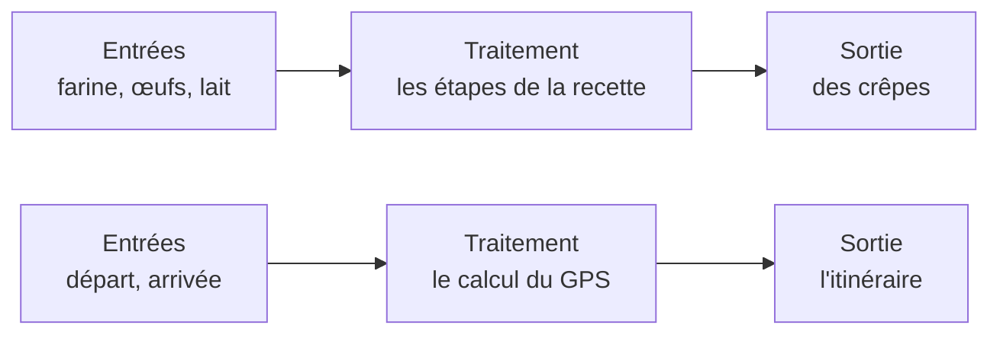
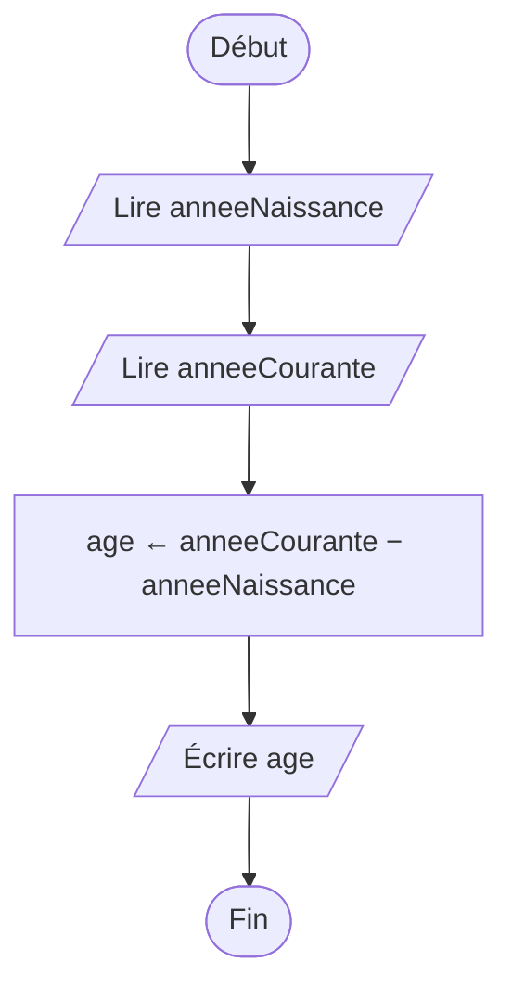
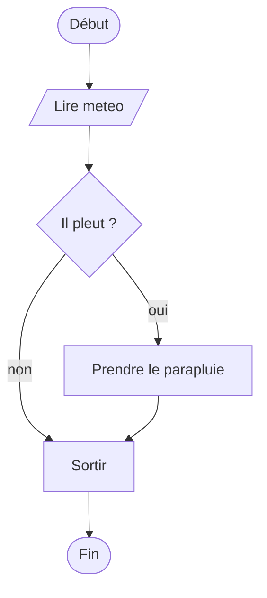
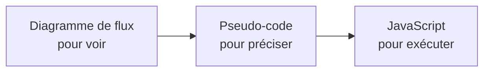
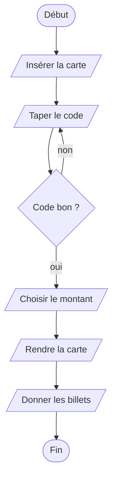
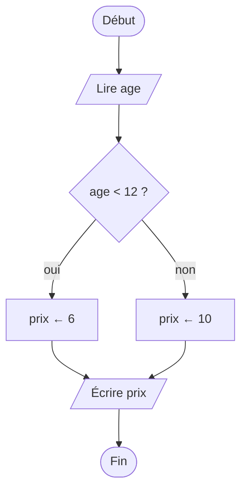
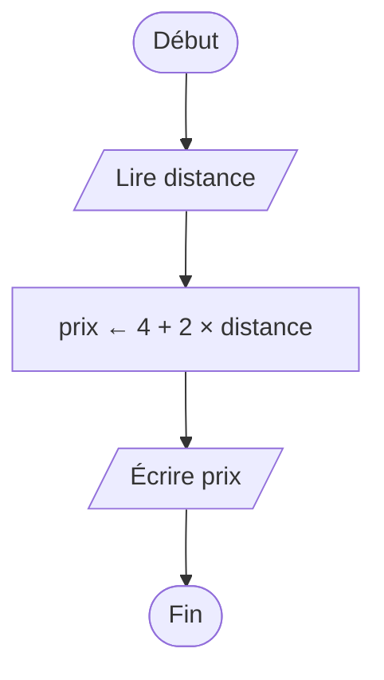

[← Chapitre précédent](01-Mise-en-route.md) · [Sommaire](Readme.md) · [Chapitre suivant →](03-La-sequence.md)

# Qu'est-ce qu'un algorithme ?

## 🎯 Objectifs

À la fin de ce chapitre, vous saurez :

1. Définir un algorithme, et repérer ses entrées, son traitement et ses sorties.
2. Dire ce qui distingue un algorithme d'une liste de conseils : il s'arrête, il est précis, sans ambiguïté.
3. Lire et dessiner un diagramme de flux avec ses quatre symboles.
4. Lire et écrire un pseudo-code simple.
5. Passer d'une écriture à l'autre : diagramme, pseudo-code, JavaScript.

> ⏱ **Durée indicative** : 45 min · **Exercices** : 2.1 à 2.3 obligatoires, 2.4 en approfondissement. Ils se font dans le playground, sans test automatique : on y rédige sa réponse et on y dessine ses diagrammes.

---

## 1. L'idée : une recette de cuisine

Une recette de crêpes indique ce qu'il faut réunir — farine, œufs, lait —, la suite des gestes à faire dans l'ordre, et ce qu'on obtient à la fin : des crêpes. Un itinéraire de GPS ou la notice de montage d'un meuble suivent le même schéma.

C'est exactement ce qu'est un **algorithme** :

> Un algorithme est une **suite finie d'instructions précises** qui, à partir de données en **entrée**, produit un **résultat** en sortie.



Le mot vient du nom d'un mathématicien persan du IXᵉ siècle, Al-Khwârizmî, qui décrivait des méthodes de calcul pas à pas. On n'a pas attendu les ordinateurs pour écrire des algorithmes : la méthode de la division posée, apprise à l'école, en est un.

### Ce qu'on attend d'un algorithme

Une recette de grand-mère n'est pas toujours un algorithme. Pour en être un, une suite d'instructions doit avoir quatre qualités :

| Qualité | Ce que ça veut dire | Contre-exemple |
|---|---|---|
| **Finie** | elle s'arrête toujours, au bout d'un nombre fini d'étapes | « remuer » sans dire jusqu'à quand |
| **Précise** | chaque instruction n'a qu'une seule interprétation possible | « saler à votre goût », « une pincée » |
| **Exécutable** | chaque instruction est faisable par celui qui l'exécute | « réussir une pâte bien lisse » |
| **Entrées et sorties définies** | on sait ce qu'elle reçoit, et ce qu'elle produit | une recette sans liste d'ingrédients |

### L'ordinateur, un exécutant parfaitement obéissant

Un cuisinier comble les trous d'une recette avec son expérience. Un ordinateur, jamais : il exécute **exactement** ce qu'on lui écrit, **dans l'ordre**, sans rien deviner ni rien rattraper. Demandez-lui de « faire chauffer la poêle », il la chauffera jusqu'à ce que quelqu'un l'arrête.

Programmer, c'est donc d'abord **penser l'algorithme** jusqu'au bout — tous les cas, toutes les étapes —, puis le **traduire** dans un langage que la machine comprend.

| | Algorithme | Programme |
|---|---|---|
| C'est… | la méthode | la traduction de la méthode dans un langage |
| Écrit en… | français structuré, ou dessiné | JavaScript, Python, Java… |
| Exécuté par… | une personne, à la main | un ordinateur |
| Combien ? | un algorithme… | … peut donner autant de programmes que de langages |

---

## 2. Le diagramme de flux

Le **diagramme de flux** (on dit aussi *organigramme* ou *logigramme*) dessine un algorithme. On le lit en suivant les flèches, du début à la fin. Quatre symboles suffisent :

| Forme | Rôle | Exemple |
|---|---|---|
| rectangle aux bords arrondis | **début** et **fin** | `Début`, `Fin` |
| parallélogramme | **entrée** ou **sortie** : lire une donnée, afficher un résultat | `Lire prix`, `Écrire total` |
| rectangle | **action** : un calcul, une affectation | `total ← prix × quantité` |
| losange | **décision** : une question à réponse oui ou non ; deux flèches en sortent | `âge ≥ 18 ?` |

Les **flèches** donnent l'ordre d'exécution. Un cinquième symbole, le rectangle à double bord, viendra avec les fonctions au chapitre 06.

### Un premier diagramme : calculer un âge



Les instructions s'enchaînent de haut en bas, une seule fois chacune : c'est une **séquence**, le sujet du chapitre suivant.

### Un diagramme avec une décision



Du losange partent **deux** flèches, étiquetées *oui* et *non* : l'algorithme doit dire quoi faire dans les deux cas. Les deux chemins se rejoignent ensuite. On approfondira les décisions au chapitre 04.

---

## 3. Le pseudo-code

Dès que l'algorithme grandit, le diagramme devient encombrant. Le **pseudo-code** écrit le même algorithme en **français structuré** : assez rigoureux pour ne laisser aucune ambiguïté, assez libre pour ne dépendre d'aucun langage. C'est le pont entre l'idée et le code.

Le même calcul d'âge :

```text
ALGORITHME CalculerAge
VARIABLES
  anneeNaissance, anneeCourante, age : NOMBRE
DÉBUT
  LIRE anneeNaissance
  LIRE anneeCourante
  age ← anneeCourante − anneeNaissance
  ÉCRIRE "Vous avez ", age, " ans"
FIN
```

### Les conventions de ce cours

Le pseudo-code n'a pas de norme officielle : chaque cours, chaque livre a ses habitudes. Voici celles de ce cours ; l'[aide-mémoire](A-Aide-memoire.md) les rassemble toutes.

| Pseudo-code | Signification |
|---|---|
| `ALGORITHME Nom` | le nom de l'algorithme |
| `VARIABLES` | la liste des variables utilisées, avec leur type : `NOMBRE`, `TEXTE`, `BOOLÉEN` |
| `DÉBUT` … `FIN` | le corps de l'algorithme |
| `LIRE x` | recevoir une valeur de l'extérieur et la ranger dans `x` |
| `ÉCRIRE …` | afficher ; les morceaux séparés par des virgules s'affichent bout à bout |
| `x ← valeur` | **affectation** : ranger `valeur` dans la variable `x` |
| `+ − × /` | les opérations ; `MOD` et `DIV` viendront au chapitre 03 |

Quelques règles d'écriture :

- **une instruction par ligne** ;
- l'**indentation** (le décalage vers la droite) montre ce qui est à l'intérieur de quoi : ici, tout ce qui est entre `DÉBUT` et `FIN` ;
- la flèche `←` se lit **de droite à gauche** : on calcule ce qui est à droite, puis on range le résultat dans la variable de gauche. `x ← x + 1` veut dire « x prend la valeur de x plus 1 ».

> La variable, sa déclaration et l'affectation sont présentées en détail au [chapitre 01 du cours *Concepts généraux en programmation*](https://github.com/DiginamicAcademy/Principes-generaux-en-programmation/blob/main/01-Variables-et-constantes.md), avec l'image des boîtes étiquetées. Le chapitre suivant en fait un rappel rapide.

---

## 4. Du pseudo-code au JavaScript

La traduction est presque mot à mot :

| Pseudo-code | JavaScript |
|---|---|
| `LIRE anneeNaissance` | `const anneeNaissance = lire("anneeNaissance");` |
| `LIRE anneeCourante` | `const anneeCourante = lire("anneeCourante");` |
| `age ← anneeCourante − anneeNaissance` | `const age = anneeCourante - anneeNaissance;` |
| `ÉCRIRE "Vous avez ", age, " ans"` | `console.log("Vous avez " + age + " ans");` |

```javascript
const anneeNaissance = lire("anneeNaissance");
const anneeCourante = lire("anneeCourante");
const age = anneeCourante - anneeNaissance;
console.log("Vous avez " + age + " ans");   // Vous avez 36 ans
```

Essayez-le dans le **bac à sable console** du playground, avec ces entrées :

```text
anneeNaissance = 1990
anneeCourante = 2026
```

Trois écritures, un seul algorithme. Dans la suite du cours, chaque notion passe par les trois, dans cet ordre.



---

## 5. Les pièges

- **L'instruction vague.** « Cuire un peu », « vérifier que c'est bon » : l'ordinateur ne sait pas faire. Chaque instruction doit pouvoir être exécutée sans réfléchir.
- **Le cas oublié.** Une décision a toujours deux issues. Que se passe-t-il s'il ne pleut pas ? Si le panier est vide ? Si l'âge est négatif ?
- **L'algorithme qui ne s'arrête pas.** « Tant que la poêle n'est pas chaude, attendre » : et si la plaque est éteinte ?
- **Coder avant de réfléchir.** Écrire du code sans savoir quel algorithme on traduit, c'est chercher son chemin en roulant au hasard. Le diagramme ou le pseudo-code d'abord.

---

## 6. Exercices

Ces exercices n'ont rien à exécuter, mais tout à réfléchir. Faites-les dans le playground (exercices 2.1 à 2.4) : la réponse se rédige dans la zone de texte, et les diagrammes se dessinent dans l'**éditeur de schémas**. Cliquez ensuite sur **✓ J'ai terminé**, puis comparez avec la correction : votre réponse figure dans votre journal.

### Exercice 2.1 ⭐ — Remettre dans l'ordre

Voici, dans le désordre, les étapes d'un retrait d'argent au distributeur :

- Prendre les billets
- Taper son code secret
- Récupérer sa carte
- Insérer sa carte
- Choisir le montant

1. Remettez-les dans l'ordre.
2. Quelles sont les **entrées** de cet algorithme ? Sa **sortie** ?
3. Il manque une **décision** importante. Laquelle ? Que se passe-t-il dans chacun des deux cas ?

<details>
<summary>Voir la correction</summary>

1. Insérer sa carte → Taper son code secret → Choisir le montant → Récupérer sa carte → Prendre les billets. La plupart des distributeurs rendent la carte **avant** les billets, pour qu'on ne l'oublie pas dans la machine : l'ordre des instructions n'est jamais anodin.
2. Entrées : la carte, le code secret, le montant demandé. Sortie : les billets (et la carte rendue).
3. Le code est-il bon ? Si oui, on continue ; si non, on redemande le code, et au bout de trois erreurs la carte est gardée. On peut aussi penser à « le solde est-il suffisant ? ».



</details>

### Exercice 2.2 ⭐ — Lire un diagramme



Qu'affiche cet algorithme si l'on saisit `8` ? `12` ? `30` ? Écrivez-le ensuite en pseudo-code, avec un `SI … ALORS … SINON … FIN SI`.

<details>
<summary>Voir la correction</summary>

- `8` : 8 est inférieur à 12, on suit le *oui* : il affiche **6** ;
- `12` : 12 n'est **pas** strictement inférieur à 12, on suit le *non* : il affiche **10** ;
- `30` : **10**.

Le cas `12` est le piège : à la frontière, tout dépend de `<` ou `≤`. Toujours tester les valeurs limites.

```text
ALGORITHME PrixCinema
VARIABLES
  age, prix : NOMBRE
DÉBUT
  LIRE age
  SI age < 12 ALORS
    prix ← 6
  SINON
    prix ← 10
  FIN SI
  ÉCRIRE prix
FIN
```

</details>

### Exercice 2.3 ⭐⭐ — Le prix d'une course en taxi

Une course de taxi coûte **4 €** de prise en charge, plus **2 € par kilomètre**.

1. Quelles sont l'entrée et la sortie de l'algorithme qui calcule le prix d'une course ?
2. Dessinez son diagramme de flux.
3. Écrivez son pseudo-code.
4. Combien coûte une course de 7 km ? Vérifiez en « exécutant » votre pseudo-code à la main.

<details>
<summary>Voir la correction</summary>

1. Entrée : la distance en kilomètres. Sortie : le prix de la course.
2. Le diagramme :



3. Le pseudo-code :

```text
ALGORITHME PrixTaxi
VARIABLES
  distance, prix : NOMBRE
DÉBUT
  LIRE distance
  prix ← 4 + 2 × distance
  ÉCRIRE "Prix : ", prix, " €"
FIN
```

4. Pour 7 km : prix ← 4 + 2 × 7 = 4 + 14 = **18 €**. La multiplication passe avant l'addition, comme en mathématiques.

Et en JavaScript, à essayer dans le bac à sable console avec `distance = 7` :

```javascript
const distance = lire("distance");
const prix = 4 + 2 * distance;
console.log("Prix : " + prix + " €");   // Prix : 18 €
```

</details>

### Exercice 2.4 ⭐⭐⭐ — La chasse aux ambiguïtés

Voici une recette :

> Faire bouillir de l'eau. Ajouter du sel. Mettre les pâtes. Cuire le temps qu'il faut, en remuant de temps en temps. Égoutter.

1. Relevez tout ce qu'un robot cuisinier, qui exécute à la lettre, ne saurait pas faire.
2. Réécrivez la recette pour qu'elle devienne un algorithme : quantités, durées, conditions d'arrêt. Vous aurez besoin d'une instruction du type « TANT QUE … répéter … ».

<details>
<summary>Voir la correction</summary>

1. Les ambiguïtés :
   - **quelle quantité** d'eau, de sel, de pâtes ? Les entrées ne sont pas définies ;
   - « faire bouillir » : comment le robot sait-il que l'eau bout ? Jusqu'à quand chauffer ?
   - « le temps qu'il faut » : combien de minutes ?
   - « de temps en temps » : toutes les combien ?
   - « égoutter » : dans quoi ? Le robot a-t-il une passoire ?
2. Une version précise, parmi d'autres :

```text
ALGORITHME CuirePates
VARIABLES
  poidsPates, minutes : NOMBRE
DÉBUT
  LIRE poidsPates                        (en grammes)
  Verser 1 litre d'eau par tranche de 100 g de pâtes dans la casserole
  Allumer la plaque au maximum
  TANT QUE l'eau ne fait pas de grosses bulles FAIRE
    Attendre 30 secondes
  FIN TANT QUE
  Ajouter 10 g de sel par litre d'eau
  Verser les pâtes
  minutes ← 0
  TANT QUE minutes < 10 FAIRE
    Attendre 1 minute
    Remuer
    minutes ← minutes + 1
  FIN TANT QUE
  Éteindre la plaque
  Verser le contenu de la casserole dans la passoire
FIN
```

Les deux `TANT QUE` sont des **boucles** : on y reviendra au chapitre 05. Le second compte les minutes dans une variable : c'est un **compteur**.

</details>

---

## ✅ Je sais…

- [ ] définir un algorithme, et citer ses quatre qualités ;
- [ ] repérer les entrées et les sorties d'un algorithme ;
- [ ] dessiner un diagramme de flux avec les symboles début/fin, entrée/sortie, action et décision ;
- [ ] lire un pseudo-code, et écrire `LIRE`, `ÉCRIRE` et une affectation `←` ;
- [ ] traduire un pseudo-code simple en JavaScript ;
- [ ] tester un algorithme à la main, en pensant aux valeurs limites.

---

[← Chapitre précédent](01-Mise-en-route.md) · [Sommaire](Readme.md) · [Chapitre suivant →](03-La-sequence.md)
