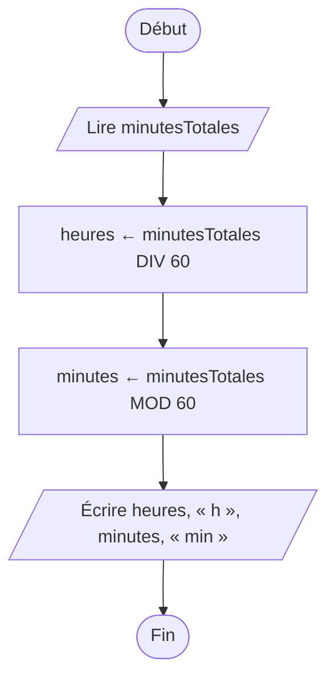

[← Chapitre précédent](02-Qu-est-ce-qu-un-algorithme.md) · [Sommaire](Readme.md) · [Chapitre suivant →](04-Les-conditions.md)

# La séquence

## 🎯 Objectifs

À la fin de ce chapitre, vous saurez :

1. Écrire une suite d'instructions exécutées dans l'ordre, et expliquer pourquoi l'ordre compte.
2. Utiliser des variables : les déclarer, leur affecter une valeur, la lire.
3. Faire des calculs, y compris le quotient et le reste d'une division entière.
4. Exécuter un algorithme à la main avec un tableau de suivi.
5. Traduire `LIRE`, `ÉCRIRE` et `←` en JavaScript.

> ⏱ **Durée indicative** : 1 h · **Exercices** : 3.1 à 3.4 obligatoires, 3.5 en approfondissement.

---

## 1. L'idée : suivre la recette dans l'ordre

Une **séquence**, c'est la structure la plus simple qui soit : des instructions exécutées **l'une après l'autre**, de haut en bas, **une seule fois** chacune. La recette se suit dans l'ordre : on casse les œufs avant de battre la pâte, et on bat la pâte avant de la cuire. Inversez deux étapes, le résultat change, ou n'a plus de sens.

En programmation, c'est pareil, avec une subtilité de plus : les instructions travaillent sur des **variables**.

### Rappel : les variables

Une variable est une **boîte étiquetée** : l'étiquette est son nom, le contenu sa valeur. Quatre gestes suffisent à tout faire avec elle :

| Geste | En pseudo-code | En JavaScript |
|---|---|---|
| déclarer la boîte | `VARIABLES total : NOMBRE` | `let total;` |
| ranger une valeur | `total ← 0` | `total = 0;` |
| lire son contenu | `ÉCRIRE total` | `console.log(total);` |
| remplacer son contenu | `total ← total + 5` | `total = total + 5;` |

Une boîte ne contient qu'**une valeur à la fois** : en ranger une nouvelle fait disparaître l'ancienne. Et chaque valeur a un **type** : `NOMBRE` (`number` en JavaScript), `TEXTE` (`string`), `BOOLÉEN` (`boolean`, qui vaut vrai ou faux).

> Ce rappel tient en quelques lignes ; les chapitres [01 Variables et constantes](https://github.com/DiginamicAcademy/Principes-generaux-en-programmation/blob/main/01-Variables-et-constantes.md) et [02 Types](https://github.com/DiginamicAcademy/Principes-generaux-en-programmation/blob/main/02-Types.md) du cours *Concepts généraux en programmation* les détaillent, conventions de nommage et pièges compris.

### Une variable ne se recalcule pas toute seule

Voici une séquence de quatre instructions :

```text
prix ← 10
quantite ← 3
total ← prix × quantite
prix ← 20
```

Que vaut `total` à la fin ? **30**, et non 60. L'instruction `total ← prix × quantite` calcule 10 × 3 **au moment où elle s'exécute**, et range 30 dans la boîte `total`. Changer `prix` ensuite ne touche pas à `total`.

C'est la grande différence avec une cellule de tableur, qui se recalcule dès qu'une de ses sources change. Une variable, elle, garde ce qu'on y a rangé, jusqu'à ce qu'on y range autre chose. **L'ordre des instructions est donc décisif.**

---

## 2. Le diagramme de flux

Fil rouge du chapitre : convertir une durée en minutes en heures et minutes. **135 minutes**, c'est **2 h 15 min**.



Pas de décision, pas de retour en arrière : une séquence se dessine comme une ligne droite.

---

## 3. Le pseudo-code

```text
ALGORITHME ConvertirMinutes
VARIABLES
  minutesTotales, heures, minutes : NOMBRE
DÉBUT
  LIRE minutesTotales
  heures ← minutesTotales DIV 60
  minutes ← minutesTotales MOD 60
  ÉCRIRE heures, " h ", minutes, " min"
FIN
```

### Quotient et reste : `DIV` et `MOD`

Partagez 135 bonbons en sachets de 60 : vous remplissez **2** sachets, et il reste **15** bonbons. Ce sont les deux résultats de la **division entière** :

- `135 DIV 60` vaut **2**, le **quotient** : combien de fois 60 « rentre » dans 135 ;
- `135 MOD 60` vaut **15**, le **reste** : ce qui ne rentre pas.

Le reste sert bien plus souvent qu'on ne le croit : un nombre est pair si `n MOD 2 = 0`, une année est bissextile selon le reste de sa division par 4, une heure sur une horloge de 12 heures se calcule par `heure MOD 12`…

| Opération | Pseudo-code | JavaScript | Exemple |
|---|---|---|---|
| addition, soustraction | `+` `−` | `+` `-` | `7 - 2` vaut `5` |
| multiplication | `×` | `*` | `7 * 2` vaut `14` |
| division | `/` | `/` | `7 / 2` vaut `3.5` |
| quotient entier | `DIV` | `Math.floor(a / b)` | `Math.floor(7 / 2)` vaut `3` |
| reste | `MOD` | `%` | `7 % 2` vaut `1` |

Comme en mathématiques, `×`, `/`, `DIV` et `MOD` passent avant `+` et `−` ; les parenthèses changent l'ordre : `4 + 2 × 3` vaut 10, `(4 + 2) × 3` vaut 18.

---

## 4. Le tableau de suivi

Pour savoir ce que fait un algorithme, rien ne vaut de l'**exécuter à la main**, comme le ferait l'ordinateur. Le **tableau de suivi** (on dit aussi *trace*) a une colonne par variable, une colonne pour ce qui s'affiche, et une ligne par instruction exécutée. On n'écrit dans une case que ce qui change.

Avec `minutesTotales = 135` :

| Instruction | minutesTotales | heures | minutes | Affichage |
|---|---|---|---|---|
| `LIRE minutesTotales` | 135 | | | |
| `heures ← minutesTotales DIV 60` | | 2 | | |
| `minutes ← minutesTotales MOD 60` | | | 15 | |
| `ÉCRIRE heures, " h ", minutes, " min"` | | | | `2 h 15 min` |

Et pour la séquence du `prix` et du `total` de la section 1 :

| Instruction | prix | quantite | total |
|---|---|---|---|
| `prix ← 10` | 10 | | |
| `quantite ← 3` | | 3 | |
| `total ← prix × quantite` | | | 30 |
| `prix ← 20` | 20 | | |

Le tableau montre d'un coup d'œil que `total` n'a pas bougé. C'est l'outil le plus simple pour comprendre un algorithme, et pour trouver ce qui cloche dans un programme qui ne fait pas ce qu'on croit. On s'en servira dans tous les chapitres.

---

## 5. En JavaScript

```javascript
const minutesTotales = lire("minutesTotales");
const heures = Math.floor(minutesTotales / 60);
const minutes = minutesTotales % 60;
console.log(heures + " h " + minutes + " min");   // 2 h 15 min
```

Ligne par ligne :

- `const` **déclare** une variable dont la valeur ne changera plus. Pour une variable qu'on réaffectera, on écrit `let`. La règle pratique : `const` par défaut, `let` seulement si la valeur doit changer ;
- `lire()` joue le rôle de `LIRE` (dans le playground seulement), `console.log()` celui de `ÉCRIRE` ;
- `Math.floor()` arrondit à l'entier inférieur : `Math.floor(135 / 60)` donne `Math.floor(2.25)`, soit 2. C'est notre `DIV`, pour les nombres positifs ;
- `%` donne le reste de la division : c'est notre `MOD` ;
- dans `console.log`, le `+` **colle** les morceaux de texte et les nombres : c'est la concaténation.

Essayez-le dans le bac à sable console, avec `minutesTotales = 135`, puis avec d'autres valeurs.

> Vous croiserez souvent une autre écriture pour assembler un texte : le **gabarit**, entre accents graves, où `${…}` insère une valeur. `` `${heures} h ${minutes} min` `` produit le même texte que `heures + " h " + minutes + " min"`. Les deux se valent ; ce cours utilise le `+`, plus proche du pseudo-code.

---

## 6. Les pièges

- **Utiliser une variable avant de lui avoir donné une valeur.** L'ordinateur lit de haut en bas : `console.log(total)` placé avant `const total = …` déclenche `ReferenceError: Cannot access 'total' before initialization`.
- **Prendre `=` pour l'égalité des mathématiques.** `x = x + 1` n'est pas une équation absurde : c'est « range dans `x` la valeur de `x` plus 1 ». En pseudo-code, on écrit `←` justement pour éviter la confusion.
- **Réaffecter une constante.** `const total = 0;` puis `total = 5;` déclenche `TypeError: Assignment to constant variable.` Si la valeur doit changer, déclarez avec `let`.
- **Additionner du texte.** `"5" + 3` donne `"53"` : dès qu'un des deux est du texte, `+` colle au lieu d'additionner. Dans le playground, `lire()` rend des nombres, mais dans une page web tout ce que l'utilisateur tape est du texte : on le convertira avec `Number()` au chapitre 06.
- **Croire que `/` fait une division entière.** En JavaScript, `7 / 2` vaut `3.5`. Pour le quotient entier, `Math.floor(7 / 2)`.
- **S'étonner des nombres à virgule.** `0.1 + 0.2` affiche `0.30000000000000004` : l'ordinateur range les nombres à virgule en binaire, avec une infime imprécision. Ce n'est pas un bug de votre code ; le [chapitre 02 Types](https://github.com/DiginamicAcademy/Principes-generaux-en-programmation/blob/main/02-Types.md) de *Concepts généraux* explique pourquoi.

---

## 7. Exercices

### Exercice 3.1 ⭐ — Le rectangle

Lisez la `largeur` et la `hauteur` d'un rectangle, puis affichez son périmètre et son aire, sur deux lignes :

| Entrées | Affichage attendu |
|---|---|
| `largeur = 4`<br>`hauteur = 3` | `Périmètre : 14`<br>`Aire : 12` |
| `largeur = 2.5`<br>`hauteur = 4` | `Périmètre : 13`<br>`Aire : 10` |

Commencez par le pseudo-code, sur papier.

<details>
<summary>Voir la correction</summary>

```text
ALGORITHME Rectangle
VARIABLES
  largeur, hauteur, perimetre, aire : NOMBRE
DÉBUT
  LIRE largeur
  LIRE hauteur
  perimetre ← 2 × (largeur + hauteur)
  aire ← largeur × hauteur
  ÉCRIRE "Périmètre : ", perimetre
  ÉCRIRE "Aire : ", aire
FIN
```

<!-- corrigé 3.1 -->
```javascript
const largeur = lire("largeur");
const hauteur = lire("hauteur");
const perimetre = 2 * (largeur + hauteur);
const aire = largeur * hauteur;
console.log("Périmètre : " + perimetre);
console.log("Aire : " + aire);
```

Les parenthèses de `2 * (largeur + hauteur)` sont indispensables : sans elles, la multiplication passerait avant l'addition, et `2 * largeur + hauteur` donnerait 11 au lieu de 14.

</details>

### Exercice 3.2 ⭐ — Le ticket de caisse

Lisez le nom d'un `article`, son `prixUnitaire` et la `quantite` achetée, puis affichez la ligne du ticket :

| Entrées | Affichage attendu |
|---|---|
| `article = livre`<br>`prixUnitaire = 12`<br>`quantite = 3` | `3 x livre à 12 € = 36 €` |
| `article = cahier`<br>`prixUnitaire = 4.5`<br>`quantite = 2` | `2 x cahier à 4.5 € = 9 €` |

<details>
<summary>Voir la correction</summary>

<!-- corrigé 3.2 -->
```javascript
const article = lire("article");
const prixUnitaire = lire("prixUnitaire");
const quantite = lire("quantite");
const total = prixUnitaire * quantite;
console.log(quantite + " x " + article + " à " + prixUnitaire + " € = " + total + " €");
```

Le plus délicat est l'assemblage du texte : chaque morceau fixe est entre guillemets, avec ses espaces, et chaque variable est collée par un `+`. Calculer `total` dans une variable à part rend la dernière ligne plus lisible que d'y écrire le calcul.

</details>

### Exercice 3.3 ⭐⭐ — Exécuter à la main

Dans le playground (exercice 3.3, sans test automatique), remplissez le tableau de suivi de ce programme, pour `a = 5` et `b = 3` :

```text
LIRE a
LIRE b
a ← a + b
b ← a − b
a ← a − b
ÉCRIRE "a = ", a, ", b = ", b
```

Que fait ce programme, quelles que soient les valeurs de départ ? Vérifiez ensuite votre réponse en le traduisant en JavaScript dans le bac à sable console.

<details>
<summary>Voir la correction</summary>

| Instruction | a | b | Affichage |
|---|---|---|---|
| `LIRE a` | 5 | | |
| `LIRE b` | | 3 | |
| `a ← a + b` | 8 | | |
| `b ← a − b` | | 5 | |
| `a ← a − b` | 3 | | |
| `ÉCRIRE …` | | | `a = 3, b = 5` |

Le programme **échange** les valeurs de `a` et `b`, sans utiliser de troisième variable. La façon habituelle passe par une variable temporaire, comme pour échanger le contenu de deux verres il faut un troisième verre : `temp ← a`, `a ← b`, `b ← temp`.

```javascript
let a = lire("a");
let b = lire("b");
a = a + b;
b = a - b;
a = a - b;
console.log("a = " + a + ", b = " + b);   // a = 3, b = 5
```

`a` et `b` changent de valeur : elles sont déclarées avec `let`, pas avec `const`.

</details>

### Exercice 3.4 ⭐⭐ — Des secondes aux heures

Lisez un nombre de `secondes` et affichez-le en heures, minutes et secondes :

| Entrées | Affichage attendu |
|---|---|
| `secondes = 3725` | `1 h 2 min 5 s` |
| `secondes = 59` | `0 h 0 min 59 s` |
| `secondes = 86399` | `23 h 59 min 59 s` |

Une heure fait 3600 secondes. Faites le tableau de suivi pour 3725 avant de coder.

<details>
<summary>Voir la correction</summary>

```text
ALGORITHME ConvertirSecondes
VARIABLES
  secondes, heures, reste, minutes, secondesRestantes : NOMBRE
DÉBUT
  LIRE secondes
  heures ← secondes DIV 3600
  reste ← secondes MOD 3600
  minutes ← reste DIV 60
  secondesRestantes ← reste MOD 60
  ÉCRIRE heures, " h ", minutes, " min ", secondesRestantes, " s"
FIN
```

| Instruction | secondes | heures | reste | minutes | secondesRestantes |
|---|---|---|---|---|---|
| `LIRE secondes` | 3725 | | | | |
| `heures ← secondes DIV 3600` | | 1 | | | |
| `reste ← secondes MOD 3600` | | | 125 | | |
| `minutes ← reste DIV 60` | | | | 2 | |
| `secondesRestantes ← reste MOD 60` | | | | | 5 |

<!-- corrigé 3.4 -->
```javascript
const secondes = lire("secondes");
const heures = Math.floor(secondes / 3600);
const reste = secondes % 3600;
const minutes = Math.floor(reste / 60);
const secondesRestantes = reste % 60;
console.log(heures + " h " + minutes + " min " + secondesRestantes + " s");
```

L'idée clé : on retire d'abord les heures pleines, et l'on travaille ensuite sur le **reste**. C'est la même méthode qu'au chapitre précédent, appliquée deux fois.

</details>

### Exercice 3.5 ⭐⭐⭐ — Rendre la monnaie

Un distributeur rend la monnaie avec des billets de 20 €, 10 € et 5 €, et des pièces de 2 € et 1 €, en utilisant toujours **le moins de billets et de pièces possible**. Lisez un `montant` entier en euros, et affichez combien de billets et de pièces de chaque sorte il faut rendre :

| Entrées | Affichage attendu |
|---|---|
| `montant = 73` | `Billets de 20 € : 3`<br>`Billets de 10 € : 1`<br>`Billets de 5 € : 0`<br>`Pièces de 2 € : 1`<br>`Pièces de 1 € : 1` |

<details>
<summary>Voir la correction</summary>

Le principe : commencer par la plus grosse coupure, en prendre autant que possible (`DIV`), et continuer avec ce qui reste (`MOD`).

```text
ALGORITHME RendreMonnaie
VARIABLES
  montant, reste : NOMBRE
DÉBUT
  LIRE montant
  ÉCRIRE "Billets de 20 € : ", montant DIV 20
  reste ← montant MOD 20
  ÉCRIRE "Billets de 10 € : ", reste DIV 10
  reste ← reste MOD 10
  ÉCRIRE "Billets de 5 € : ", reste DIV 5
  reste ← reste MOD 5
  ÉCRIRE "Pièces de 2 € : ", reste DIV 2
  reste ← reste MOD 2
  ÉCRIRE "Pièces de 1 € : ", reste
FIN
```

<!-- corrigé 3.5 -->
```javascript
const montant = lire("montant");
let reste = montant;
console.log("Billets de 20 € : " + Math.floor(reste / 20));
reste = reste % 20;
console.log("Billets de 10 € : " + Math.floor(reste / 10));
reste = reste % 10;
console.log("Billets de 5 € : " + Math.floor(reste / 5));
reste = reste % 5;
console.log("Pièces de 2 € : " + Math.floor(reste / 2));
reste = reste % 2;
console.log("Pièces de 1 € : " + reste);
```

La variable `reste` est **réaffectée** à chaque étape : elle est déclarée avec `let`. Vous remarquerez que le code répète cinq fois le même geste, à la coupure près : au chapitre 07, une boucle sur un tableau de coupures le fera en quelques lignes (exercice 7.9). Cette stratégie, prendre à chaque étape la plus grosse part possible, s'appelle un **algorithme glouton**.

</details>

---

## ✅ Je sais…

- [ ] expliquer ce qu'est une séquence, et pourquoi l'ordre des instructions compte ;
- [ ] déclarer une variable avec `const` ou `let`, et choisir entre les deux ;
- [ ] utiliser le quotient (`DIV`, `Math.floor(a / b)`) et le reste (`MOD`, `%`) ;
- [ ] remplir un tableau de suivi pour exécuter un algorithme à la main ;
- [ ] traduire `LIRE`, `ÉCRIRE` et `←` en JavaScript ;
- [ ] assembler un texte à afficher avec `+`.

---

[← Chapitre précédent](02-Qu-est-ce-qu-un-algorithme.md) · [Sommaire](Readme.md) · [Chapitre suivant →](04-Les-conditions.md)
