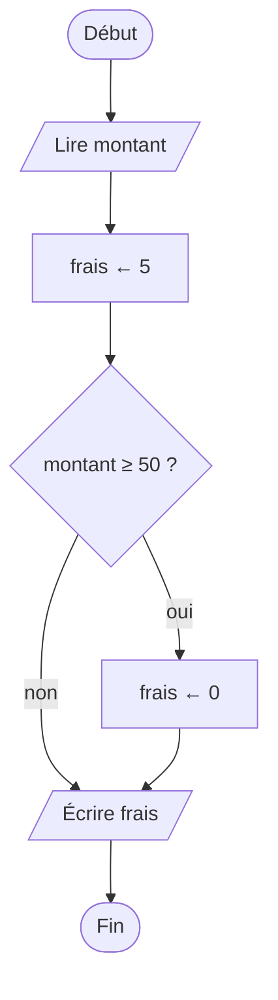
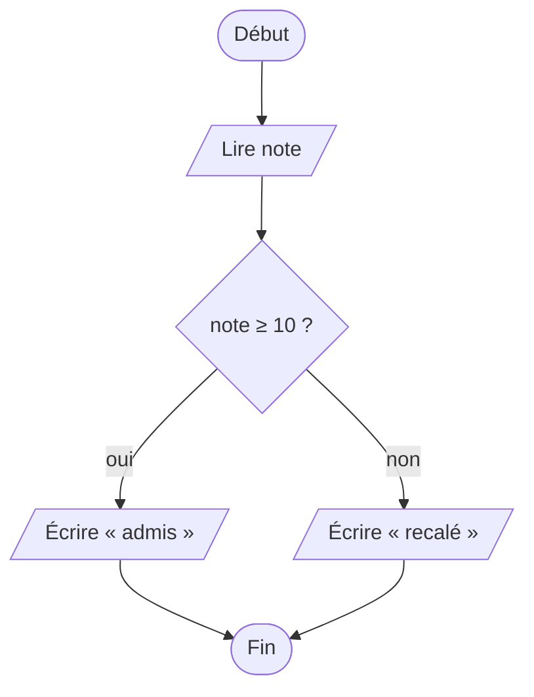
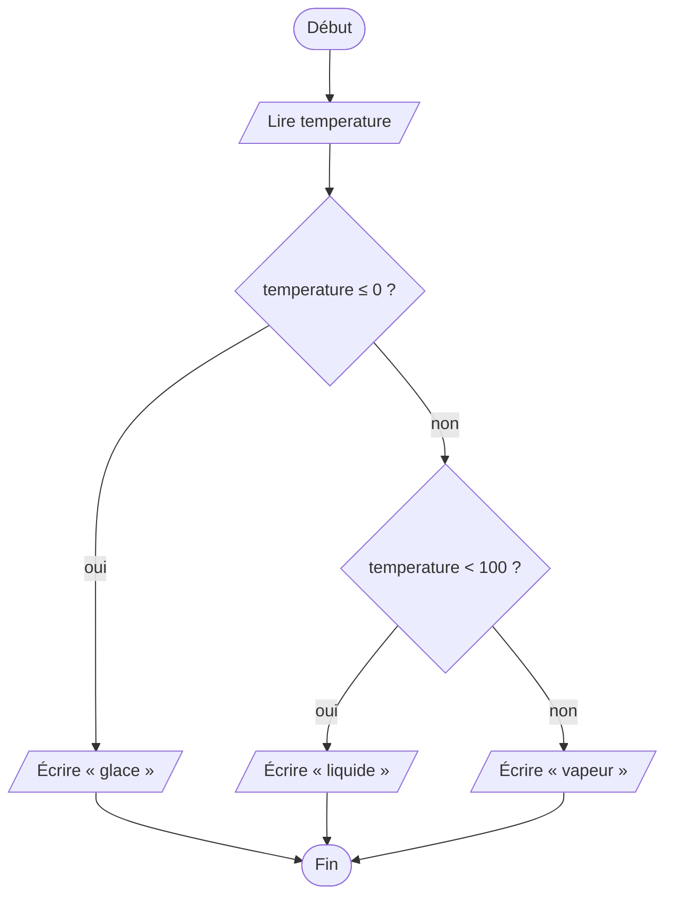

[← Chapitre précédent](03-La-sequence.md) · [Sommaire](Readme.md) · [Chapitre suivant →](05-Les-boucles.md)

# Les conditions

## 🎯 Objectifs

À la fin de ce chapitre, vous saurez :

1. Écrire une condition : une question dont la réponse est vrai ou faux.
2. Comparer des valeurs, et combiner des conditions avec ET, OU et NON.
3. Faire un choix avec `SI … ALORS … SINON`, et enchaîner plusieurs cas avec `SINON SI`.
4. Dessiner une décision dans un diagramme de flux.
5. Traduire tout cela en JavaScript : `if`, `else`, `===`, `&&`, `||`, `!`.
6. Choisir les valeurs avec lesquelles tester un programme, frontières comprises.

> ⏱ **Durée indicative** : 1 h 30 · **Exercices** : 4.1 à 4.4 obligatoires, 4.5 et 4.6 en approfondissement.

---

## 1. L'idée : l'aiguillage

Jusqu'ici, nos programmes filaient tout droit. Mais un programme doit souvent **choisir** : la livraison est-elle gratuite ? Le mot de passe est-il bon ? L'élève est-il admis ?

Pensez à un **aiguillage** de chemin de fer : selon sa position, le train part à gauche ou à droite. Ou au contrôle à l'entrée d'un concert : « si tu as 18 ans ou plus, tu entres ; sinon, tu restes dehors ». L'aiguillage obéit à une **condition** : une question dont la réponse est **oui ou non**.

### Vrai ou faux : les booléens

La réponse à une condition est une valeur d'un type particulier, le **booléen**, qui ne connaît que deux valeurs : **VRAI** et **FAUX** (`true` et `false` en JavaScript). Une comparaison produit un booléen : si `age` vaut 20, `age ≥ 18` vaut VRAI ; si `age` vaut 15, elle vaut FAUX.

| Comparaison | Pseudo-code | JavaScript | Exemple vrai |
|---|---|---|---|
| égal | `=` | `===` | `3 === 3` |
| différent | `≠` | `!==` | `3 !== 4` |
| strictement inférieur, supérieur | `<` `>` | `<` `>` | `2 < 5` |
| inférieur ou égal, supérieur ou égal | `≤` `≥` | `<=` `>=` | `5 >= 5` |

> En JavaScript, l'égalité s'écrit avec **trois** signes égal : `===`. Un seul `=` est une affectation, et `==` (deux signes) compare de façon trop permissive : `"5" == 5` est vrai. Prenez l'habitude de `===` et `!==` : le [chapitre 02 Types](https://github.com/DiginamicAcademy/Principes-generaux-en-programmation/blob/main/02-Types.md) de *Concepts généraux* explique pourquoi.

### Combiner des conditions : ET, OU, NON

- « Pour louer une voiture, il faut avoir 21 ans **ET** le permis » : les **deux** conditions doivent être vraies.
- « Entrée gratuite pour les moins de 12 ans **OU** les plus de 65 ans » : **une seule** suffit.
- « S'il ne pleut **pas** » : **NON** inverse une condition.

Les **tables de vérité** donnent le résultat dans tous les cas :

| A | B | A ET B | A OU B |
|---|---|---|---|
| VRAI | VRAI | VRAI | VRAI |
| VRAI | FAUX | FAUX | VRAI |
| FAUX | VRAI | FAUX | VRAI |
| FAUX | FAUX | FAUX | FAUX |

| A | NON A |
|---|---|
| VRAI | FAUX |
| FAUX | VRAI |

Attention au OU : contrairement au « fromage ou dessert » du restaurant, le OU logique est **inclusif** : si les deux conditions sont vraies, `A OU B` est vrai.

---

## 2. Le diagramme de flux

Une décision se dessine avec un **losange**, d'où partent deux flèches, *oui* et *non*. Trois formes reviennent sans cesse.

**Une action seulement si** : la livraison coûte 5 €, sauf à partir de 50 € d'achat.



**L'un ou l'autre** : admis à partir de 10, recalé en dessous.



**Plusieurs cas, testés dans l'ordre** : l'eau est de la glace jusqu'à 0 °C, liquide jusqu'à 100 °C, de la vapeur au-delà. C'est le fil rouge de la suite du chapitre.



Remarquez qu'on n'atteint le second losange que si la température est **au-dessus de 0** : inutile de le redemander.

---

## 3. Le pseudo-code

Les trois formes du diagramme ont chacune leur écriture :

```text
SI condition ALORS
  instructions si vrai
FIN SI

SI condition ALORS
  instructions si vrai
SINON
  instructions si faux
FIN SI

SI condition1 ALORS
  …
SINON SI condition2 ALORS
  …
SINON
  …
FIN SI
```

Le fil rouge :

```text
ALGORITHME EtatDeLEau
VARIABLES
  temperature : NOMBRE
DÉBUT
  LIRE temperature
  SI temperature ≤ 0 ALORS
    ÉCRIRE "glace"
  SINON SI temperature < 100 ALORS
    ÉCRIRE "liquide"
  SINON
    ÉCRIRE "vapeur"
  FIN SI
FIN
```

Les conditions sont examinées **dans l'ordre**, de haut en bas. **La première qui est vraie gagne** : ses instructions s'exécutent, et toutes les suivantes sont ignorées. Le `SINON` final ramasse tout ce qui reste.

### Des conditions dans des conditions

Un `SI` peut en contenir un autre : on parle de conditions **imbriquées**. Pour louer une voiture :

```text
SI age ≥ 21 ALORS
  SI aLePermis ALORS
    ÉCRIRE "Location acceptée"
  SINON
    ÉCRIRE "Permis obligatoire"
  FIN SI
SINON
  ÉCRIRE "Il faut avoir 21 ans"
FIN SI
```

L'imbrication permet un message précis pour chaque refus. Si seul le cas « accepté » comptait, une seule condition suffirait : `SI age ≥ 21 ET aLePermis ALORS`.

---

## 4. En JavaScript

```javascript
const temperature = lire("temperature");
if (temperature <= 0) {
  console.log("glace");
} else if (temperature < 100) {
  console.log("liquide");
} else {
  console.log("vapeur");
}
```

| Pseudo-code | JavaScript |
|---|---|
| `SI condition ALORS` | `if (condition) {` |
| `SINON SI condition ALORS` | `} else if (condition) {` |
| `SINON` | `} else {` |
| `FIN SI` | `}` |
| `ET`, `OU`, `NON` | `&&`, `\|\|`, `!` |
| `=`, `≠` | `===`, `!==` |

La condition se met **entre parenthèses** ; les instructions à exécuter, **entre accolades**. L'indentation n'est pas obligatoire pour JavaScript, mais elle l'est pour les humains qui vous liront, à commencer par vous.

La location de voiture, avec des conditions combinées :

```javascript
const age = lire("age");
const aLePermis = lire("aLePermis");   // dans les Entrées : aLePermis = true

if (age >= 21 && aLePermis) {
  console.log("Location acceptée");
} else {
  console.log("Location refusée");
}
```

Une condition n'est qu'une **valeur booléenne** : on peut la ranger dans une variable, ce qui rend le code plus lisible, et l'utiliser telle quelle. Inutile d'écrire `if (aLePermis === true)` : `if (aLePermis)` dit la même chose.

```javascript
const estMajeur = age >= 18;
if (!estMajeur) {
  console.log("Accès réservé aux adultes");
}
```

> Vous croiserez deux autres écritures. Le **`switch`** choisit parmi des valeurs précises (`case "lundi":`…) ; il ne sait pas tester un intervalle, et ce cours s'en passe. L'**opérateur ternaire** `condition ? siVrai : siFaux` choisit entre deux valeurs en une ligne : `const etat = note >= 10 ? "admis" : "recalé";`. Pratique, mais à réserver aux choix simples.

---

## 5. Choisir ses tests : les valeurs limites

Un programme avec des conditions a plusieurs **chemins**. Pour avoir confiance en lui, il faut passer par chacun d'eux, et surtout **par les frontières**, là où se cachent les bugs : un `<` à la place d'un `≤` ne change rien pour 50 °C, tout pour 0 °C ou 100 °C.

Pour l'état de l'eau :

| Valeur | Pourquoi | Attendu |
|---|---|---|
| −5 | un cas typique de glace | glace |
| **0** | frontière glace / liquide | glace |
| 1 | juste après la frontière | liquide |
| 50 | un cas typique de liquide | liquide |
| 99 | juste avant la frontière | liquide |
| **100** | frontière liquide / vapeur | vapeur |
| 150 | un cas typique de vapeur | vapeur |

C'est exactement ce que font les tests du playground. Prenez l'habitude d'y penser vous-même : **un cas typique par chemin, et chaque frontière**.

---

## 6. Les pièges

- **`=` au lieu de `===`.** `if (age = 18)` ne compare pas : il range 18 dans `age`. Avec `const`, c'est une erreur ; avec `let`, la condition est toujours vraie, et le bug passe inaperçu.
- **Le mauvais ordre des `SINON SI`.** La première condition vraie gagne : si l'on teste `note >= 10` avant `note >= 16`, une note de 18 s'arrête à « Passable » et « Très bien » n'est jamais atteint. Du plus restrictif au plus large, ou dans l'ordre des intervalles.
- **L'encadrement des mathématiques.** `if (0 < x < 10)` ne fait pas ce qu'on croit : JavaScript calcule `0 < x`, obtient `true` ou `false`, puis compare ce booléen à 10. Écrivez `if (x > 0 && x < 10)`.
- **Le OU raccourci.** `if (couleur === "rouge" || "orange")` est toujours vrai : `"orange"` tout seul n'est pas une comparaison. Il faut répéter : `couleur === "rouge" || couleur === "orange"`.
- **Le point-virgule de trop.** `if (x > 0); { … }` : le `;` termine le `if`, et le bloc entre accolades s'exécute dans tous les cas.
- **Les accolades oubliées.** Sans accolades, seule la première instruction dépend du `if`. Mettez-les toujours, même pour une seule ligne.

---

## 7. Exercices

Pour chaque exercice, commencez par le diagramme ou le pseudo-code, et listez les valeurs limites à tester.

### Exercice 4.1 ⭐ — Majeur ou mineur

Lisez un `age` et affichez `majeur` s'il vaut au moins 18, `mineur` sinon.

| Entrées | Affichage attendu |
|---|---|
| `age = 17` | `mineur` |
| `age = 18` | `majeur` |

<details>
<summary>Voir la correction</summary>

<!-- corrigé 4.1 -->
```javascript
const age = lire("age");
if (age >= 18) {
  console.log("majeur");
} else {
  console.log("mineur");
}
```

Le test qui compte est `age = 18`, la frontière : avec `age > 18`, il afficherait « mineur ».

</details>

### Exercice 4.2 ⭐ — Pair ou impair

Lisez un nombre entier `n` et affichez s'il est pair ou impair :

| Entrées | Affichage attendu |
|---|---|
| `n = 8` | `8 est pair` |
| `n = 7` | `7 est impair` |

<details>
<summary>Voir la correction</summary>

Un nombre est pair si le reste de sa division par 2 vaut 0 : `n MOD 2 = 0`.

<!-- corrigé 4.2 -->
```javascript
const n = lire("n");
if (n % 2 === 0) {
  console.log(n + " est pair");
} else {
  console.log(n + " est impair");
}
```

0 est pair (son reste est 0). Pour les nombres négatifs, `-7 % 2` vaut `-1` en JavaScript, et non `1` : c'est pourquoi on teste `=== 0` plutôt que `=== 1`.

</details>

### Exercice 4.3 ⭐⭐ — Le tarif du cinéma

Lisez un `age` et un booléen `etudiant` (`true` ou `false`), et affichez le tarif :

- moins de 12 ans : **6 €** ;
- sinon, étudiant ou moins de 18 ans : **8 €** ;
- sinon, 65 ans ou plus : **7 €** ;
- sinon : **11 €**.

| Entrées | Affichage attendu |
|---|---|
| `age = 8`<br>`etudiant = false` | `Tarif : 6 €` |
| `age = 22`<br>`etudiant = true` | `Tarif : 8 €` |
| `age = 70`<br>`etudiant = false` | `Tarif : 7 €` |

<details>
<summary>Voir la correction</summary>

```text
ALGORITHME TarifCinema
VARIABLES
  age, tarif : NOMBRE
  etudiant : BOOLÉEN
DÉBUT
  LIRE age
  LIRE etudiant
  SI age < 12 ALORS
    tarif ← 6
  SINON SI etudiant OU age < 18 ALORS
    tarif ← 8
  SINON SI age ≥ 65 ALORS
    tarif ← 7
  SINON
    tarif ← 11
  FIN SI
  ÉCRIRE "Tarif : ", tarif, " €"
FIN
```

<!-- corrigé 4.3 -->
```javascript
const age = lire("age");
const etudiant = lire("etudiant");
let tarif;
if (age < 12) {
  tarif = 6;
} else if (etudiant || age < 18) {
  tarif = 8;
} else if (age >= 65) {
  tarif = 7;
} else {
  tarif = 11;
}
console.log("Tarif : " + tarif + " €");
```

Ranger le tarif dans une variable, puis l'afficher **une seule fois** à la fin, évite de répéter quatre fois le même `console.log` : si le format change, il n'y a qu'une ligne à modifier. La variable est déclarée avec `let` avant le `if`, sans valeur : elle en reçoit une dans chaque branche.

L'ordre des cas compte : un enfant de 8 ans étudiant paie 6 €, parce que `age < 12` est testé en premier.

</details>

### Exercice 4.4 ⭐⭐ — La mention

Lisez une `note` sur 20 et affichez la mention :

| Note | Mention |
|---|---|
| en dessous de 10 | `Insuffisant` |
| de 10 à moins de 12 | `Passable` |
| de 12 à moins de 14 | `Assez bien` |
| de 14 à moins de 16 | `Bien` |
| 16 et plus | `Très bien` |

Une note inférieure à 0 ou supérieure à 20 affiche `Note invalide`.

<details>
<summary>Voir la correction</summary>

<!-- corrigé 4.4 -->
```javascript
const note = lire("note");
if (note < 0 || note > 20) {
  console.log("Note invalide");
} else if (note < 10) {
  console.log("Insuffisant");
} else if (note < 12) {
  console.log("Passable");
} else if (note < 14) {
  console.log("Assez bien");
} else if (note < 16) {
  console.log("Bien");
} else {
  console.log("Très bien");
}
```

Les cas invalides sont écartés **en premier** : la suite peut alors supposer que la note est entre 0 et 20. Ensuite, les intervalles sont testés dans l'ordre croissant : quand on arrive à `note < 12`, on sait déjà que `note >= 10`, inutile de l'écrire.

Les valeurs à tester : une par mention, et chaque frontière, 10, 12, 14, 16, ainsi que 0, 20, −1 et 21.

</details>

### Exercice 4.5 ⭐⭐⭐ — Année bissextile

Une année est **bissextile** si elle est divisible par 4 mais pas par 100, **ou** si elle est divisible par 400. Lisez une `annee` et affichez la réponse :

| Entrées | Affichage attendu |
|---|---|
| `annee = 2024` | `2024 est bissextile` |
| `annee = 1900` | `1900 n'est pas bissextile` |
| `annee = 2000` | `2000 est bissextile` |

<details>
<summary>Voir la correction</summary>

« Divisible par 4 » se traduit par « le reste de la division par 4 vaut 0 » :

<!-- corrigé 4.5 -->
```javascript
const annee = lire("annee");
const bissextile = (annee % 4 === 0 && annee % 100 !== 0) || annee % 400 === 0;
if (bissextile) {
  console.log(annee + " est bissextile");
} else {
  console.log(annee + " n'est pas bissextile");
}
```

La condition est rangée dans une variable au nom parlant : le `if` se lit alors comme une phrase. Les parenthèses autour du `ET` ne sont pas obligatoires (`&&` passe avant `||`), mais elles rendent la règle lisible.

On peut aussi écrire la règle avec des conditions imbriquées : divisible par 400 → oui ; sinon, divisible par 100 → non ; sinon, divisible par 4 → oui ; sinon → non. Les deux sont justes ; la première est plus compacte, la seconde plus facile à vérifier ligne à ligne.

</details>

### Exercice 4.6 ⭐⭐⭐ — Le plus grand de trois

Lisez trois nombres `a`, `b` et `c`, et affichez le plus grand, **sans utiliser `Math.max`** :

| Entrées | Affichage attendu |
|---|---|
| `a = 3`<br>`b = 9`<br>`c = 5` | `Le plus grand est 9` |
| `a = -4`<br>`b = -2`<br>`c = -8` | `Le plus grand est -2` |

<details>
<summary>Voir la correction</summary>

Plutôt que de comparer toutes les combinaisons, on garde **le plus grand vu jusqu'ici**, et l'on regarde chaque nouveau nombre :

```text
max ← a
SI b > max ALORS
  max ← b
FIN SI
SI c > max ALORS
  max ← c
FIN SI
ÉCRIRE "Le plus grand est ", max
```

<!-- corrigé 4.6 -->
```javascript
const a = lire("a");
const b = lire("b");
const c = lire("c");
let max = a;
if (b > max) {
  max = b;
}
if (c > max) {
  max = c;
}
console.log("Le plus grand est " + max);
```

Ce sont deux `if` **indépendants**, pas un `else if` : il faut comparer `c` même si `b` a remplacé `a`. Cette méthode, le **meilleur jusqu'ici**, a un gros avantage : avec dix nombres, ou mille, elle reste la même. On la retrouvera au chapitre 07, avec une boucle.

</details>

---

## ✅ Je sais…

- [ ] écrire une comparaison, et savoir qu'elle produit un booléen ;
- [ ] combiner des conditions avec ET (`&&`), OU (`||`) et NON (`!`), et lire une table de vérité ;
- [ ] écrire un `if`, un `if … else` et une suite de `else if`, en plaçant les cas dans le bon ordre ;
- [ ] dessiner une décision avec un losange et ses deux sorties ;
- [ ] utiliser `===` et `!==`, jamais `=` dans une condition ;
- [ ] choisir des valeurs de test : un cas par chemin, et chaque frontière.

---

[← Chapitre précédent](03-La-sequence.md) · [Sommaire](Readme.md) · [Chapitre suivant →](05-Les-boucles.md)
