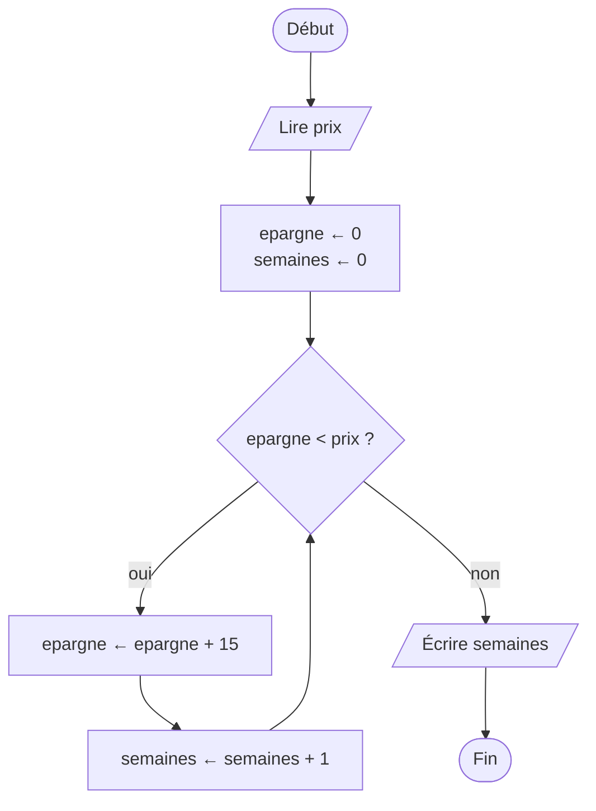
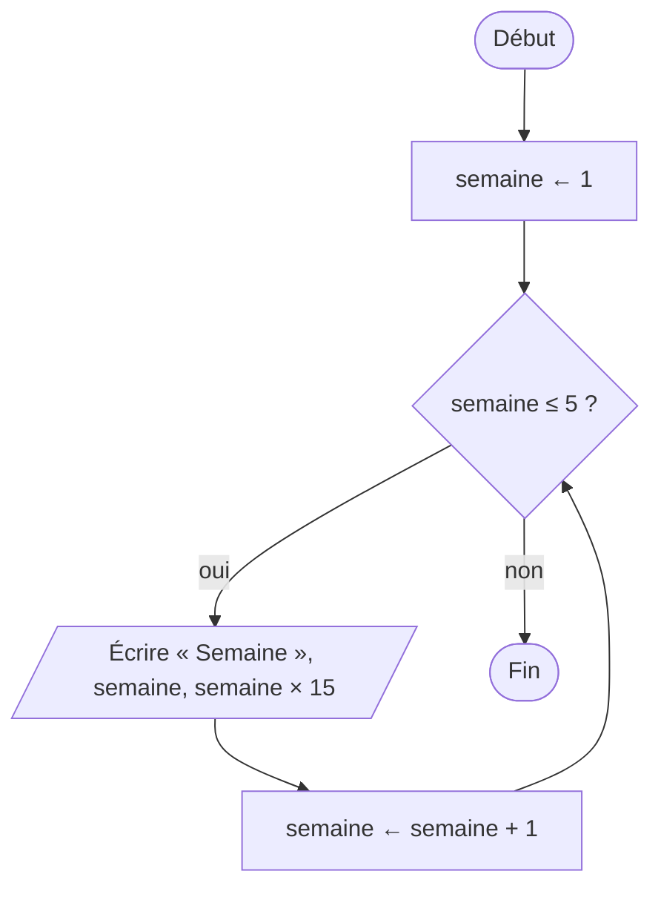
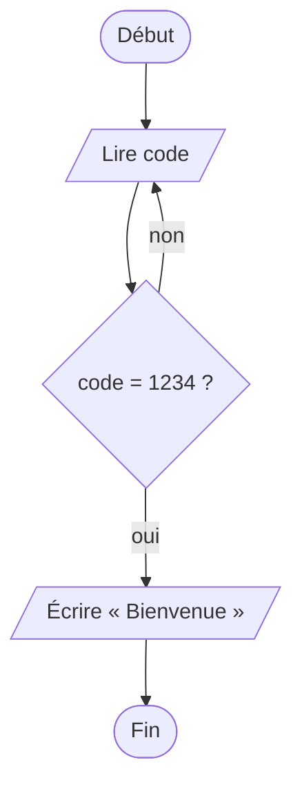

[← Chapitre précédent](04-Les-conditions.md) · [Sommaire](Readme.md) · [Chapitre suivant →](06-Les-fonctions.md)

# Les boucles

## 🎯 Objectifs

À la fin de ce chapitre, vous saurez :

1. Répéter des instructions avec une boucle, et dire quand elle s'arrête.
2. Choisir entre `TANT QUE`, `POUR` et `RÉPÉTER … JUSQU'À`.
3. Utiliser un compteur et un accumulateur.
4. Repérer et éviter une boucle infinie.
5. Imbriquer deux boucles.
6. Traduire tout cela en JavaScript : `while`, `for`, `do … while`.

> ⏱ **Durée indicative** : 1 h 45 · **Exercices** : 5.1 à 5.6 obligatoires, 5.7 et 5.8 en approfondissement.

---

## 1. L'idée : faire la vaisselle

« **Tant qu'**il reste des assiettes sales, laver une assiette. » Vous ne savez pas à l'avance combien il y en a ; vous regardez **avant chaque assiette** s'il en reste. S'il n'y en a aucune, vous ne lavez rien.

D'autres situations répètent un geste, mais autrement :

- « Faire **10 tours** de piste » : là, on sait d'avance combien de fois ;
- « Taper son code **jusqu'à ce qu'**il soit bon » : on ne sait pas combien d'essais il faudra, mais il y en aura **au moins un**.

Une **boucle** répète un bloc d'instructions, son **corps**. Chaque passage s'appelle un **tour**, ou une **itération**. Trois sortes de boucles correspondent aux trois situations :

| Boucle | Nombre de tours connu d'avance ? | La condition est testée… | Image |
|---|---|---|---|
| `TANT QUE` | non | **avant** chaque tour : il peut n'y en avoir aucun | la vaisselle |
| `POUR` | **oui** | un compteur avance tout seul, d'une valeur à une autre | les 10 tours de piste |
| `RÉPÉTER … JUSQU'À` | non | **après** chaque tour : il y en a au moins un | le code à taper |

---

## 2. Le diagramme de flux

Fil rouge du chapitre : **la tirelire**. Chaque semaine, vous mettez 15 € de côté. Combien de semaines faut-il pour vous offrir un objet de `prix` euros ?

Dans un diagramme, une boucle est une **décision avec une flèche qui remonte** :



La question est posée **avant** chaque tour : c'est un `TANT QUE`. Tant que la réponse est oui, on fait un tour et l'on remonte ; dès qu'elle est non, on sort de la boucle.

La boucle `POUR` a la même forme, avec un compteur qui avance automatiquement. Afficher les 5 premières semaines d'épargne :



La boucle `RÉPÉTER`, elle, fait le tour **d'abord** et pose la question **ensuite** :



---

## 3. Le pseudo-code

```text
TANT QUE condition FAIRE
  instructions
FIN TANT QUE

POUR i DE 1 À n FAIRE
  instructions
FIN POUR

RÉPÉTER
  instructions
JUSQU'À condition
```

La tirelire :

```text
ALGORITHME Tirelire
VARIABLES
  prix, epargne, semaines : NOMBRE
DÉBUT
  LIRE prix
  epargne ← 0
  semaines ← 0
  TANT QUE epargne < prix FAIRE
    epargne ← epargne + 15
    semaines ← semaines + 1
  FIN TANT QUE
  ÉCRIRE "Il faut ", semaines, " semaines."
FIN
```

Les cinq premières semaines :

```text
POUR semaine DE 1 À 5 FAIRE
  ÉCRIRE "Semaine ", semaine, " : ", semaine × 15, " €"
FIN POUR
```

Pour compter à rebours, on précise le pas : `POUR i DE 10 À 1 PAS -1 FAIRE`.

Attention au sens de la condition : `TANT QUE` donne la condition pour **continuer**, `JUSQU'À` la condition pour **s'arrêter**. `RÉPÉTER … JUSQU'À code = 1234` s'arrête quand le code est bon.

---

## 4. Compteur, accumulateur, et le tableau de suivi d'une boucle

Deux variables reviennent dans presque toutes les boucles :

- le **compteur** compte les tours : `semaines ← semaines + 1`. Il part de 0 et augmente de 1 à chaque tour ;
- l'**accumulateur** cumule des valeurs au fil des tours : `epargne ← epargne + 15`. C'est le total du ticket de caisse, qui grossit à chaque article scanné.

Tous deux **s'initialisent avant la boucle** : à 0 pour une somme ou un comptage, à 1 pour un produit.

Le tableau de suivi d'une boucle a une ligne par tour, et une colonne pour la condition. Avec `prix = 40` :

| Étape | epargne | semaines | epargne < prix ? |
|---|---|---|---|
| avant la boucle | 0 | 0 | 0 < 40 : VRAI, on entre |
| après le tour 1 | 15 | 1 | 15 < 40 : VRAI, on continue |
| après le tour 2 | 30 | 2 | 30 < 40 : VRAI, on continue |
| après le tour 3 | 45 | 3 | 45 < 40 : FAUX, on sort |

Puis `ÉCRIRE` affiche `Il faut 3 semaines.` Faire ce tableau sur deux ou trois tours suffit en général à comprendre une boucle, ou à trouver pourquoi elle ne fait pas ce qu'on attend.

---

## 5. En JavaScript

### `while` : le TANT QUE

```javascript
const prix = lire("prix");
let epargne = 0;
let semaines = 0;
while (epargne < prix) {
  epargne = epargne + 15;
  semaines = semaines + 1;
}
console.log("Il faut " + semaines + " semaines.");
```

### `for` : le POUR

```javascript
for (let semaine = 1; semaine <= 5; semaine++) {
  console.log("Semaine " + semaine + " : " + semaine * 15 + " €");
}
```

Les parenthèses du `for` contiennent trois parties, séparées par des points-virgules :

| Partie | Ici | Rôle | Quand ? |
|---|---|---|---|
| initialisation | `let semaine = 1` | déclarer le compteur et lui donner sa valeur de départ | une fois, avant tout |
| condition | `semaine <= 5` | continuer tant qu'elle est vraie | avant chaque tour |
| pas | `semaine++` | faire avancer le compteur | après chaque tour |

`semaine++` est un raccourci pour `semaine = semaine + 1`, et `semaine--` pour `semaine = semaine - 1`. De même, `epargne += 15` raccourcit `epargne = epargne + 15`. À rebours : `for (let i = 10; i >= 1; i--)`.

### `do … while` : le RÉPÉTER

```javascript
let code;
do {
  code = lire("code");   // Entrées : code = 1111, 0000, 1234
} while (code !== 1234);
console.log("Bienvenue");
```

JavaScript n'a pas de `JUSQU'À` : son `do … while` prend la condition pour **continuer**. Il faut donc **inverser** la condition du pseudo-code : `JUSQU'À code = 1234` devient `while (code !== 1234)`.

| Pseudo-code | JavaScript |
|---|---|
| `TANT QUE c FAIRE … FIN TANT QUE` | `while (c) { … }` |
| `POUR i DE a À b FAIRE … FIN POUR` | `for (let i = a; i <= b; i++) { … }` |
| `POUR i DE b À a PAS -1 FAIRE …` | `for (let i = b; i >= a; i--) { … }` |
| `RÉPÉTER … JUSQU'À c` | `do { … } while (!c);` |

### Des boucles dans des boucles

Une boucle peut en contenir une autre : pour **chaque** tour de la boucle extérieure, la boucle intérieure fait **tous** ses tours. C'est l'horloge : pour chaque heure, les minutes font le tour complet de 0 à 59.

```javascript
for (let ligne = 1; ligne <= 3; ligne++) {
  let texte = "";
  for (let colonne = 1; colonne <= 3; colonne++) {
    texte = texte + (ligne * colonne) + " ";
  }
  console.log(texte);
}
// 1 2 3
// 2 4 6
// 3 6 9
```

`texte` est un accumulateur de **texte** : il part vide, `""`, et grossit d'un morceau à chaque tour de la boucle intérieure. Il est remis à vide au début de chaque ligne, et affiché à la fin de chaque ligne.

> **Sortir avant la fin.** L'instruction `break` interrompt immédiatement la boucle en cours. Elle dépanne, mais une boucle qui s'arrête « au milieu » est plus difficile à suivre : préférez une condition de boucle qui dit tout, comme dans la correction de l'exercice 5.8.

---

## 6. La boucle infinie

Une boucle dont la condition ne devient **jamais fausse** ne s'arrête jamais. Les causes habituelles :

- **la variable de la condition ne change pas** dans le corps : `while (epargne < prix)` sans jamais modifier `epargne` ;
- **la condition saute par-dessus sa cible** : `for (let i = 0; i !== 10; i += 3)` passe par 9 puis 12, sans jamais valoir 10. Préférez `<` ou `<=` à `!==` ;
- **on modifie la mauvaise variable** : `semaine++` dans une boucle sur `i`.

Le playground arrête un programme au bout de 3 secondes ; un navigateur ordinaire, lui, se fige. Avant d'exécuter une boucle, posez-vous deux questions : **qu'est-ce qui change à chaque tour ?** et **est-ce que ce changement rapproche la condition de devenir fausse ?**

---

## 7. Les pièges

- **Le décalage d'un.** Faut-il `i < n` ou `i <= n` ? Partir de 0 ou de 1 ? De `a` à `b` inclus, il y a `b − a + 1` tours. Vérifiez sur un petit cas : avec `n = 3`, combien de tours fait votre boucle ?
- **L'accumulateur initialisé dans la boucle.** `let somme = 0;` placé **dans** la boucle remet la somme à zéro à chaque tour. Il s'initialise **avant**.
- **L'affichage dans la boucle.** Un `console.log(somme)` placé dans la boucle affiche toutes les sommes intermédiaires ; pour n'afficher que le résultat, placez-le **après** l'accolade fermante.
- **Le `let` oublié dans le `for`.** `for (i = 0; …)` utilise une variable `i` jamais déclarée : en mode strict, c'est une erreur.
- **Toucher au compteur d'un `for`.** Modifier `i` dans le corps d'un `for` rend la boucle imprévisible. Si le nombre de tours dépend de ce qui se passe dans la boucle, c'est un `while` qu'il faut.

---

## 8. Exercices

### Exercice 5.1 ⭐ — Compte à rebours

Lisez un entier `n`, affichez les nombres de `n` à 1, puis `Décollage !` :

| Entrées | Affichage attendu |
|---|---|
| `n = 3` | `3`<br>`2`<br>`1`<br>`Décollage !` |
| `n = 0` | `Décollage !` |

<details>
<summary>Voir la correction</summary>

<!-- corrigé 5.1 -->
```javascript
const n = lire("n");
for (let i = n; i >= 1; i--) {
  console.log(i);
}
console.log("Décollage !");
```

Avec `n = 0`, la condition `0 >= 1` est fausse dès le départ : la boucle ne fait aucun tour, et seul « Décollage ! » s'affiche. Le `console.log("Décollage !")` est **après** la boucle : il ne s'exécute qu'une fois.

Avec un `while`, il faut gérer le compteur soi-même :

```javascript
let i = lire("n");
while (i >= 1) {
  console.log(i);
  i--;
}
console.log("Décollage !");
```

</details>

### Exercice 5.2 ⭐ — La table de multiplication

Lisez un entier `n` et affichez sa table de multiplication, de 1 à 10 :

| Entrées | Affichage attendu |
|---|---|
| `n = 7` | `7 x 1 = 7`<br>`7 x 2 = 14`<br>…<br>`7 x 10 = 70` |

<details>
<summary>Voir la correction</summary>

<!-- corrigé 5.2 -->
```javascript
const n = lire("n");
for (let i = 1; i <= 10; i++) {
  console.log(n + " x " + i + " = " + n * i);
}
```

On sait d'avance qu'il y a 10 lignes : c'est une boucle `POUR`. Dans `n + " x " + i + " = " + n * i`, la multiplication `n * i` est calculée d'abord, puis tout est collé de gauche à droite.

</details>

### Exercice 5.3 ⭐⭐ — La somme de 1 à n

Lisez un entier `n` et affichez la somme 1 + 2 + … + n :

| Entrées | Affichage attendu |
|---|---|
| `n = 10` | `Somme : 55` |
| `n = 100` | `Somme : 5050` |
| `n = 0` | `Somme : 0` |

<details>
<summary>Voir la correction</summary>

```text
somme ← 0
POUR i DE 1 À n FAIRE
  somme ← somme + i
FIN POUR
ÉCRIRE "Somme : ", somme
```

<!-- corrigé 5.3 -->
```javascript
const n = lire("n");
let somme = 0;
for (let i = 1; i <= n; i++) {
  somme = somme + i;
}
console.log("Somme : " + somme);
```

`somme` est un accumulateur : initialisé à 0 **avant** la boucle, augmenté à chaque tour, affiché **après**. Le tableau de suivi pour `n = 4` : somme vaut 0, puis 1, 3, 6, 10.

Le jeune Gauss, raconte-t-on, aurait trouvé la formule `n × (n + 1) / 2` à l'école en quelques secondes. Elle donne le même résultat sans boucle, mais l'objectif ici était d'écrire l'accumulateur.

</details>

### Exercice 5.4 ⭐⭐ — La saisie contrôlée

Lisez une `note` ; tant qu'elle n'est pas comprise entre 0 et 20, affichez `Note invalide : …` et lisez-en une autre. Une fois une note valide obtenue, affichez `Note enregistrée : …`.

Dans les Entrées, `note = 25, -3, 12` fournit trois saisies successives : chaque `lire("note")` donne la suivante.

| Entrées | Affichage attendu |
|---|---|
| `note = 25, -3, 12` | `Note invalide : 25`<br>`Note invalide : -3`<br>`Note enregistrée : 12` |
| `note = 15` | `Note enregistrée : 15` |

<details>
<summary>Voir la correction</summary>

On lit au moins une fois, et l'on recommence jusqu'à obtenir une note valide : c'est un `RÉPÉTER … JUSQU'À`.

```text
RÉPÉTER
  LIRE note
  SI note < 0 OU note > 20 ALORS
    ÉCRIRE "Note invalide : ", note
  FIN SI
JUSQU'À note ≥ 0 ET note ≤ 20
ÉCRIRE "Note enregistrée : ", note
```

<!-- corrigé 5.4 -->
```javascript
let note;
do {
  note = lire("note");
  if (note < 0 || note > 20) {
    console.log("Note invalide : " + note);
  }
} while (note < 0 || note > 20);
console.log("Note enregistrée : " + note);
```

La condition du `while` est l'**inverse** de celle du `JUSQU'À` : on continue tant que la note est invalide. `note` est déclarée **avant** la boucle, sans valeur : déclarée dans les accolades, elle n'existerait plus après, et le dernier `console.log` ne la trouverait pas.

</details>

### Exercice 5.5 ⭐⭐ — La moyenne, jusqu'à −1

Lisez des notes l'une après l'autre ; la valeur `-1` signale la fin de la saisie. Affichez le nombre de notes et leur moyenne, ou `Aucune note` si la première valeur est déjà `-1`.

| Entrées | Affichage attendu |
|---|---|
| `note = 12, 15, 9, 14, -1` | `Nombre de notes : 4`<br>`Moyenne : 12.5` |
| `note = -1` | `Aucune note` |

<details>
<summary>Voir la correction</summary>

La valeur `-1` n'est pas une note, mais un signal d'arrêt : on l'appelle une **sentinelle**. Elle ne doit pas entrer dans la somme. La méthode classique : lire une première valeur **avant** la boucle, puis lire la suivante **à la fin** de chaque tour.

```text
somme ← 0
nombre ← 0
LIRE note
TANT QUE note ≠ -1 FAIRE
  somme ← somme + note
  nombre ← nombre + 1
  LIRE note
FIN TANT QUE
SI nombre = 0 ALORS
  ÉCRIRE "Aucune note"
SINON
  ÉCRIRE "Nombre de notes : ", nombre
  ÉCRIRE "Moyenne : ", somme / nombre
FIN SI
```

<!-- corrigé 5.5 -->
```javascript
let somme = 0;
let nombre = 0;
let note = lire("note");
while (note !== -1) {
  somme = somme + note;
  nombre = nombre + 1;
  note = lire("note");
}
if (nombre === 0) {
  console.log("Aucune note");
} else {
  console.log("Nombre de notes : " + nombre);
  console.log("Moyenne : " + somme / nombre);
}
```

Un compteur et un accumulateur travaillent ensemble. Le test `nombre === 0` évite de diviser par zéro : en JavaScript, `0 / 0` ne plante pas, mais donne `NaN` (*Not a Number*), ce qu'on ne veut pas afficher.

</details>

### Exercice 5.6 ⭐⭐ — FizzBuzz

Lisez un entier `n`. Pour chaque nombre de 1 à `n`, affichez :

- `FizzBuzz` s'il est divisible par 3 **et** par 5 ;
- sinon `Fizz` s'il est divisible par 3 ;
- sinon `Buzz` s'il est divisible par 5 ;
- sinon le nombre lui-même.

| Entrées | Affichage attendu |
|---|---|
| `n = 15` | `1`, `2`, `Fizz`, `4`, `Buzz`, `Fizz`, `7`, `8`, `Fizz`, `Buzz`, `11`, `Fizz`, `13`, `14`, `FizzBuzz`, un par ligne |

Ce petit exercice est célèbre : il sert souvent de premier test en entretien d'embauche de développeur.

<details>
<summary>Voir la correction</summary>

<!-- corrigé 5.6 -->
```javascript
const n = lire("n");
for (let i = 1; i <= n; i++) {
  if (i % 3 === 0 && i % 5 === 0) {
    console.log("FizzBuzz");
  } else if (i % 3 === 0) {
    console.log("Fizz");
  } else if (i % 5 === 0) {
    console.log("Buzz");
  } else {
    console.log(i);
  }
}
```

Une condition **dans** une boucle. Le piège est l'ordre des cas : si l'on teste `i % 3 === 0` en premier, 15 affiche « Fizz » et le cas « FizzBuzz » n'est jamais atteint. Le cas le plus restrictif passe d'abord ; `i % 15 === 0` marche aussi pour lui.

</details>

### Exercice 5.7 ⭐⭐⭐ — Le triangle d'étoiles

Lisez un entier `n` et affichez un triangle de `n` lignes : une étoile sur la première, deux sur la deuxième, et ainsi de suite. Sans utiliser `repeat`.

| Entrées | Affichage attendu |
|---|---|
| `n = 4` | `*`<br>`**`<br>`***`<br>`****` |

<details>
<summary>Voir la correction</summary>

Deux boucles imbriquées : l'extérieure parcourt les lignes, l'intérieure construit chaque ligne étoile par étoile.

```text
POUR ligne DE 1 À n FAIRE
  texte ← ""
  POUR etoile DE 1 À ligne FAIRE
    texte ← texte + "*"
  FIN POUR
  ÉCRIRE texte
FIN POUR
```

<!-- corrigé 5.7 -->
```javascript
const n = lire("n");
for (let ligne = 1; ligne <= n; ligne++) {
  let texte = "";
  for (let etoile = 1; etoile <= ligne; etoile++) {
    texte = texte + "*";
  }
  console.log(texte);
}
```

La boucle intérieure fait `ligne` tours : son nombre de tours dépend du tour de la boucle extérieure. Au total, le programme ajoute 1 + 2 + … + n étoiles, la somme de l'exercice 5.3.

</details>

### Exercice 5.8 ⭐⭐⭐ — Nombre premier

Un nombre est **premier** s'il n'a que deux diviseurs : 1 et lui-même. Lisez un entier `n` (au moins 2) et affichez s'il est premier ; sinon, donnez son plus petit diviseur autre que 1 :

| Entrées | Affichage attendu |
|---|---|
| `n = 17` | `17 est premier` |
| `n = 21` | `21 n'est pas premier (divisible par 3)` |

<details>
<summary>Voir la correction</summary>

On cherche un diviseur en partant de 2, et l'on s'arrête dès qu'on en trouve un, ou quand on atteint `n` :

```text
d ← 2
TANT QUE d < n ET n MOD d ≠ 0 FAIRE
  d ← d + 1
FIN TANT QUE
SI d = n ALORS
  ÉCRIRE n, " est premier"
SINON
  ÉCRIRE n, " n'est pas premier (divisible par ", d, ")"
FIN SI
```

<!-- corrigé 5.8 -->
```javascript
const n = lire("n");
let d = 2;
while (d < n && n % d !== 0) {
  d++;
}
if (d === n) {
  console.log(n + " est premier");
} else {
  console.log(n + " n'est pas premier (divisible par " + d + ")");
}
```

La condition de la boucle dit tout : elle continue tant qu'on n'a **ni** atteint `n`, **ni** trouvé de diviseur. À la sortie, il suffit de regarder pourquoi elle s'est arrêtée. Pas besoin de `break`.

Pour aller plus loin : si `n` a un diviseur, il en a forcément un inférieur ou égal à sa racine carrée. On peut donc s'arrêter dès que `d × d > n`. Pour un nombre comme 1 000 003, cela fait environ 1 000 tours au lieu d'un million : c'est une première idée de la **complexité**, que l'on verra au chapitre 09.

</details>

---

## ✅ Je sais…

- [ ] choisir entre `while`, `for` et `do … while` selon la situation ;
- [ ] écrire les trois parties d'un `for` ;
- [ ] utiliser un compteur et un accumulateur, initialisés avant la boucle ;
- [ ] faire le tableau de suivi d'une boucle sur quelques tours ;
- [ ] vérifier qu'une boucle s'arrête, et repérer une boucle infinie ;
- [ ] traiter une suite de valeurs terminée par une sentinelle ;
- [ ] imbriquer deux boucles.

---

[← Chapitre précédent](04-Les-conditions.md) · [Sommaire](Readme.md) · [Chapitre suivant →](06-Les-fonctions.md)
