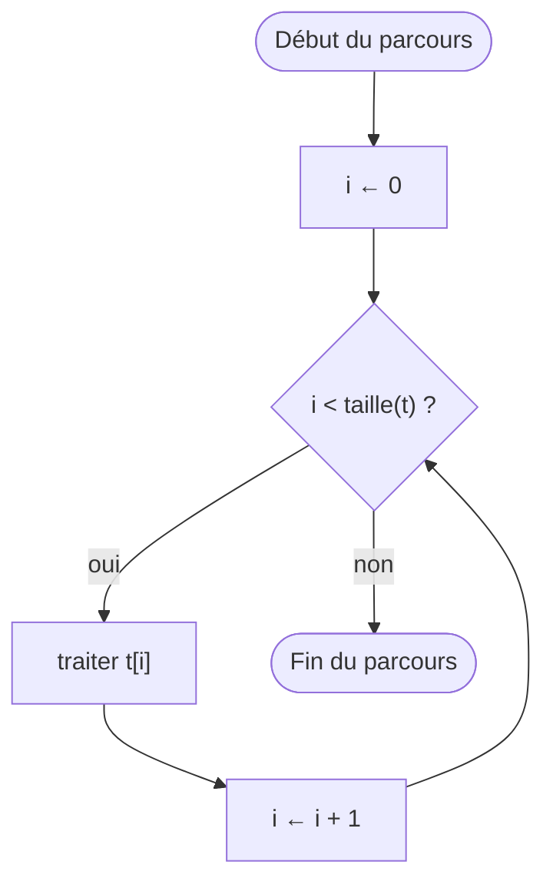
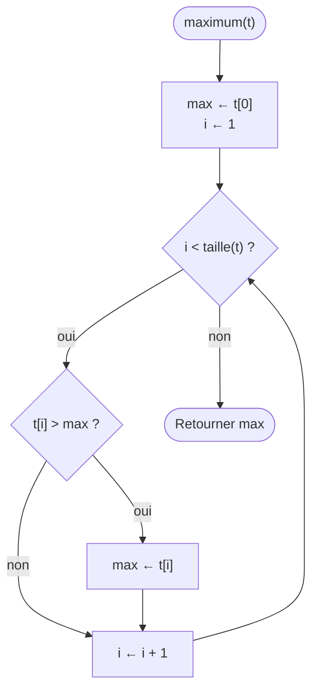

[← Chapitre précédent](06-Les-fonctions.md) · [Sommaire](Readme.md) · [Chapitre suivant →](08-Trier-et-chercher.md)

# Algorithmes sur les tableaux

## 🎯 Objectifs

À la fin de ce chapitre, vous saurez :

1. Parcourir un tableau, avec ou sans indice.
2. Reconnaître et écrire les cinq patrons classiques : accumulateur, meilleur jusqu'ici, compteur, drapeau, construction.
3. Écrire une fonction qui reçoit un tableau et retourne un résultat.
4. Éviter les sorties de tableau, et penser au tableau vide.

> ⏱ **Durée indicative** : 1 h 30 · **Exercices** : 7.1 à 7.6 obligatoires, 7.7 à 7.9 en approfondissement.

---

## 1. L'idée : une colonne de tableur

Jusqu'ici, chaque variable contenait une seule valeur. Pour les notes d'une classe, les articles d'un panier ou les températures d'une semaine, il faut ranger **plusieurs valeurs sous un seul nom** : c'est le **tableau**.

Imaginez une colonne de tableur. Chaque case contient une valeur, et chaque case a un numéro, son **indice**, qui commence à **0**. Le tableau `notes` :

| Indice | 0 | 1 | 2 | 3 | 4 |
|---|---|---|---|---|---|
| Valeur | 12 | 15 | 9 | 18 | 7 |

| Geste | Pseudo-code | JavaScript |
|---|---|---|
| créer | `notes ← [12, 15, 9, 18, 7]` | `const notes = [12, 15, 9, 18, 7];` |
| lire une case | `notes[0]` | `notes[0]` vaut `12` |
| la taille | `taille(notes)` | `notes.length` vaut `5` |
| la dernière case | `notes[taille(notes) − 1]` | `notes[notes.length - 1]` vaut `7` |
| modifier une case | `notes[1] ← 16` | `notes[1] = 16;` |
| ajouter à la fin | `ajouter 11 à notes` | `notes.push(11);` |

En pseudo-code, on déclare un tableau avec son type : `notes : TABLEAU DE NOMBRE`.

> Tableaux, listes, ajout et retrait, et surtout le piège des **références partagées** sont détaillés au [chapitre 03 Tableaux et listes](https://github.com/DiginamicAcademy/Principes-generaux-en-programmation/blob/main/03-Tableaux-et-listes.md) du cours *Concepts généraux en programmation*. Ce chapitre-ci s'intéresse à ce qu'on **fait** d'un tableau : les algorithmes.

Presque tous les algorithmes sur les tableaux reposent sur le même geste : le **parcours**, une boucle qui visite chaque case une fois, comme la caissière qui scanne les articles du tapis, un par un. Ce qui change d'un algorithme à l'autre, c'est **ce qu'on fait à chaque case**.

---

## 2. Parcourir un tableau



En pseudo-code, deux façons d'écrire le parcours :

```text
POUR i DE 0 À taille(t) − 1 FAIRE      quand on a besoin de l'indice
  traiter t[i]
FIN POUR

POUR CHAQUE x DANS t FAIRE             quand seule la valeur compte
  traiter x
FIN POUR
```

Et en JavaScript :

```javascript
const notes = [12, 15, 9, 18, 7];

for (let i = 0; i < notes.length; i++) {
  console.log("Note n°" + i + " : " + notes[i]);
}

for (const note of notes) {
  console.log(note);
}
```

Les indices vont de 0 à `notes.length - 1` : la condition est donc `i < notes.length`, **strictement** inférieur. Le `for … of` donne directement les valeurs, sans indice : c'est le plus simple quand l'indice ne sert à rien.

---

## 3. Les cinq patrons

Un **patron** est une façon de faire qui revient sans cesse, d'un programme à l'autre. Sur les tableaux, cinq patrons couvrent l'essentiel des besoins. Chacun est écrit ici comme une fonction qui reçoit un tableau : c'est ainsi que vous les écrirez dans les exercices.

### 3.1 L'accumulateur : la somme

La caissière ajoute chaque article au total du ticket. Le total part de 0.

```text
FONCTION somme(t : TABLEAU DE NOMBRE) : NOMBRE
  total ← 0
  POUR CHAQUE x DANS t FAIRE
    total ← total + x
  FIN POUR
  RETOURNER total
FIN FONCTION
```

| Étape | x | total |
|---|---|---|
| départ | | 0 |
| tour 1 | 12 | 12 |
| tour 2 | 15 | 27 |
| tour 3 | 9 | 36 |

### 3.2 Le meilleur jusqu'ici : le maximum

Un recruteur lit les CV un par un et garde sur le bureau **le meilleur vu jusqu'ici** ; chaque nouveau CV meilleur remplace l'ancien. À la fin, le CV sur le bureau est le meilleur de tous.



```javascript
function maximum(t) {
  let max = t[0];
  for (let i = 1; i < t.length; i++) {
    if (t[i] > max) {
      max = t[i];
    }
  }
  return max;
}

console.log(maximum([12, 15, 9, 18, 7]));   // 18
console.log(maximum([-5, -2, -9]));         // -2
```

Le premier candidat est **la première case**, pas 0 : avec des nombres tous négatifs, un maximum initialisé à 0 retournerait 0, qui n'est même pas dans le tableau.

### 3.3 Le compteur : combien de… ?

Le contrôleur compte les voyageurs sans billet : il passe devant chacun, et ajoute 1 à son compte quand la condition est remplie.

```javascript
function compterAdmis(notes) {
  let nombre = 0;
  for (const note of notes) {
    if (note >= 10) {
      nombre++;
    }
  }
  return nombre;
}

console.log(compterAdmis([12, 15, 9, 18, 7]));   // 3
```

### 3.4 Le drapeau : y en a-t-il au moins un ?

Vous cherchez vos clés dans une pile de manteaux : dès que vous les trouvez, inutile de fouiller le reste. Mais pour affirmer qu'elles **n'y sont pas**, il faut avoir tout fouillé.

```text
FONCTION aUneNoteEliminatoire(notes : TABLEAU DE NOMBRE) : BOOLÉEN
  POUR CHAQUE note DANS notes FAIRE
    SI note < 5 ALORS
      RETOURNER VRAI
    FIN SI
  FIN POUR
  RETOURNER FAUX
FIN FONCTION
```

```javascript
function aUneNoteEliminatoire(notes) {
  for (const note of notes) {
    if (note < 5) {
      return true;     // trouvé : on s'arrête là
    }
  }
  return false;        // tout parcouru, rien trouvé
}
```

Le `return false` est **après** la boucle. Le placer dans un `else`, à l'intérieur de la boucle, est **l'erreur classique** : la fonction s'arrêterait dès la première case, sans regarder les autres.

On parle de **drapeau** parce que, sans `return`, on lève un booléen : `trouve ← FAUX` avant la boucle, `trouve ← VRAI` quand on trouve.

### 3.5 La construction : un nouveau tableau

Vous triez le courrier : ce qui vous intéresse va dans une nouvelle pile, le reste est laissé de côté. On part d'un tableau **vide**, et l'on y ajoute ce qui convient.

```javascript
function notesAdmises(notes) {
  const resultat = [];
  for (const note of notes) {
    if (note >= 10) {
      resultat.push(note);
    }
  }
  return resultat;
}

console.log(notesAdmises([12, 15, 9, 18, 7]));   // [12, 15, 18]
```

Le tableau reçu n'est pas modifié : on en construit un nouveau. Celui qui a appelé la fonction retrouve ses notes intactes.

### En résumé

| Patron | La question | Avant la boucle | À chaque case | Exemple |
|---|---|---|---|---|
| accumulateur | combien en tout ? | `total ← 0` | `total ← total + x` | somme, moyenne |
| meilleur jusqu'ici | lequel est le plus… ? | `max ← t[0]` | `SI x > max ALORS max ← x` | maximum, minimum, le plus long mot |
| compteur | combien de… ? | `n ← 0` | `SI condition ALORS n ← n + 1` | nombre d'admis |
| drapeau | y en a-t-il un ? | — | `SI condition ALORS RETOURNER VRAI` | contient, a une note éliminatoire |
| construction | lesquels ? | `resultat ← []` | `SI condition ALORS ajouter x` | filtrer, transformer |

### Et les méthodes toutes faites ?

JavaScript fournit ces algorithmes tout écrits : `reduce` pour accumuler, `Math.max(...t)` pour le maximum, `filter` pour construire, `includes` et `some` pour le drapeau, `indexOf` pour chercher, `reverse` pour inverser. Dans un vrai projet, **utilisez-les** : ils sont testés et lisibles.

Les exercices de ce chapitre les interdisent pourtant. Pas par goût de la difficulté : savoir ce qu'il y a **dedans** permet de choisir la bonne méthode, de comprendre ce qu'elle coûte (le chapitre 09 y revient), et de s'en sortir le jour où aucune méthode ne fait exactement ce qu'on veut.

---

## 4. Les pièges

- **Sortir du tableau.** `for (let i = 0; i <= t.length; i++)` fait un tour de trop : `t[t.length]` n'existe pas et vaut `undefined`. Une somme devient `NaN`, et `t[i].length` déclenche `Cannot read properties of undefined`.
- **Oublier le tableau vide.** Que vaut le maximum de `[]` ? La moyenne de `[]` ? `t[0]` vaut `undefined`, `0 / 0` vaut `NaN`. Décidez de ce que la fonction doit retourner dans ce cas, et testez-le.
- **Le `else return false` dans la boucle.** Voir le drapeau : la fonction répond après avoir regardé une seule case.
- **Initialiser le meilleur à 0.** Faux dès que toutes les valeurs sont négatives (pour un maximum) ou toutes supérieures à 0 (pour un minimum). Partez de la première case.
- **Modifier le tableau reçu.** Un `push` ou une affectation `t[i] = …` sur le paramètre modifie le tableau de celui qui a appelé la fonction : c'est le même tableau, pas une copie. Pour retourner un tableau différent, construisez-en un nouveau.
- **Confondre indice et valeur.** `for (const i of t)` donne les **valeurs**, malgré le nom `i`. Pour les indices, c'est le `for` classique.

---

## 5. Exercices

Tous les exercices sont en mode fonction. Écrivez votre pseudo-code d'abord, et demandez-vous chaque fois : **quel patron ?** et **que retourner pour un tableau vide ?**

### Exercice 7.1 ⭐ — La somme

Écrivez `somme(tableau)`, qui retourne la somme des nombres du tableau, et 0 pour un tableau vide. Sans `reduce`.

| Appel | Résultat attendu |
|---|---|
| `somme([12, 15, 9])` | `36` |
| `somme([])` | `0` |

<details>
<summary>Voir la correction</summary>

<!-- corrigé 7.1 -->
```javascript
function somme(tableau) {
  let total = 0;
  for (const nombre of tableau) {
    total = total + nombre;
  }
  return total;
}
```

Le patron de l'accumulateur. Le tableau vide ne demande aucun traitement particulier : la boucle ne fait aucun tour, et la fonction retourne la valeur de départ, 0.

</details>

### Exercice 7.2 ⭐ — La moyenne

Écrivez `moyenne(tableau)`, qui retourne la moyenne des nombres du tableau, et **0** pour un tableau vide. Sans `reduce`.

| Appel | Résultat attendu |
|---|---|
| `moyenne([12, 15, 9, 14])` | `12.5` |
| `moyenne([])` | `0` |

<details>
<summary>Voir la correction</summary>

<!-- corrigé 7.2 -->
```javascript
function somme(tableau) {
  let total = 0;
  for (const nombre of tableau) {
    total = total + nombre;
  }
  return total;
}

function moyenne(tableau) {
  if (tableau.length === 0) {
    return 0;
  }
  return somme(tableau) / tableau.length;
}
```

La moyenne **réutilise** la somme : une fonction qui en appelle une autre. Le cas du tableau vide est traité d'abord : sans lui, `0 / 0` retournerait `NaN`.

</details>

### Exercice 7.3 ⭐⭐ — Le minimum

Écrivez `minimum(tableau)`, qui retourne le plus petit nombre d'un tableau **non vide**. Sans `Math.min`.

| Appel | Résultat attendu |
|---|---|
| `minimum([12, 15, 9, 14])` | `9` |
| `minimum([-3, -8, -1])` | `-8` |

<details>
<summary>Voir la correction</summary>

<!-- corrigé 7.3 -->
```javascript
function minimum(tableau) {
  let min = tableau[0];
  for (let i = 1; i < tableau.length; i++) {
    if (tableau[i] < min) {
      min = tableau[i];
    }
  }
  return min;
}
```

Le patron du meilleur jusqu'ici, avec `<` au lieu de `>`. Le premier candidat est `tableau[0]` : un minimum initialisé à 0 retournerait 0 pour `[12, 15, 9]`.

</details>

### Exercice 7.4 ⭐⭐ — Compter

Écrivez `compter(tableau, valeur)`, qui retourne le nombre de fois où `valeur` apparaît dans le tableau.

| Appel | Résultat attendu |
|---|---|
| `compter([1, 2, 1, 3, 1], 1)` | `3` |
| `compter(["pomme", "poire", "pomme"], "pomme")` | `2` |

<details>
<summary>Voir la correction</summary>

<!-- corrigé 7.4 -->
```javascript
function compter(tableau, valeur) {
  let nombre = 0;
  for (const element of tableau) {
    if (element === valeur) {
      nombre++;
    }
  }
  return nombre;
}
```

Le patron du compteur. La même fonction marche pour des nombres et pour des textes : `===` compare les deux.

</details>

### Exercice 7.5 ⭐⭐ — Contient ?

Écrivez `contient(tableau, valeur)`, qui retourne `true` si `valeur` est dans le tableau, `false` sinon. Sans `includes`, `indexOf`, `some` ni `find`.

| Appel | Résultat attendu |
|---|---|
| `contient([3, 8, 1], 8)` | `true` |
| `contient([3, 8, 1], 5)` | `false` |

<details>
<summary>Voir la correction</summary>

<!-- corrigé 7.5 -->
```javascript
function contient(tableau, valeur) {
  for (const element of tableau) {
    if (element === valeur) {
      return true;
    }
  }
  return false;
}
```

Le patron du drapeau. Si votre version échoue sur `contient([3, 8, 1], 8)` alors qu'elle réussit `contient([3, 8, 1], 3)`, c'est presque sûrement un `else { return false; }` dans la boucle : la fonction s'arrête dès la première case.

</details>

### Exercice 7.6 ⭐⭐ — Filtrer

Écrivez `filtrerAuDessus(tableau, seuil)`, qui retourne un **nouveau** tableau contenant les valeurs strictement supérieures à `seuil`, dans le même ordre. Le tableau reçu ne doit pas être modifié. Sans `filter`.

| Appel | Résultat attendu |
|---|---|
| `filtrerAuDessus([12, 8, 15, 10, 9], 10)` | `[12, 15]` |
| `filtrerAuDessus([1, 2, 3], 5)` | `[]` |

<details>
<summary>Voir la correction</summary>

<!-- corrigé 7.6 -->
```javascript
function filtrerAuDessus(tableau, seuil) {
  const resultat = [];
  for (const valeur of tableau) {
    if (valeur > seuil) {
      resultat.push(valeur);
    }
  }
  return resultat;
}
```

Le patron de la construction. `resultat` est déclaré avec `const` et pourtant on y ajoute des valeurs : `const` interdit de remplacer le tableau par un autre, pas d'en changer le contenu.

</details>

### Exercice 7.7 ⭐⭐⭐ — Inverser

Écrivez `inverser(tableau)`, qui retourne un **nouveau** tableau contenant les mêmes valeurs dans l'ordre inverse. Le tableau reçu ne doit pas être modifié. Sans `reverse`.

| Appel | Résultat attendu |
|---|---|
| `inverser([1, 2, 3])` | `[3, 2, 1]` |
| `inverser([])` | `[]` |

<details>
<summary>Voir la correction</summary>

<!-- corrigé 7.7 -->
```javascript
function inverser(tableau) {
  const resultat = [];
  for (let i = tableau.length - 1; i >= 0; i--) {
    resultat.push(tableau[i]);
  }
  return resultat;
}
```

Un parcours **à rebours**, de la dernière case (`tableau.length - 1`) à la première (`0`), en construisant un nouveau tableau. Les bornes sont le point délicat : partir de `tableau.length` ajouterait un `undefined`, s'arrêter à `i > 0` oublierait la première case.

</details>

### Exercice 7.8 ⭐⭐⭐ — Trié ?

Écrivez `estTrie(tableau)`, qui retourne `true` si chaque valeur est inférieure ou égale à la suivante, `false` sinon. Un tableau vide ou d'une seule case est trié.

| Appel | Résultat attendu |
|---|---|
| `estTrie([1, 2, 2, 5])` | `true` |
| `estTrie([1, 3, 2])` | `false` |

<details>
<summary>Voir la correction</summary>

<!-- corrigé 7.8 -->
```javascript
function estTrie(tableau) {
  for (let i = 0; i < tableau.length - 1; i++) {
    if (tableau[i] > tableau[i + 1]) {
      return false;
    }
  }
  return true;
}
```

Un drapeau inversé : on cherche **une** paire de voisins mal rangés ; s'il n'y en a aucune, le tableau est trié. On compare chaque case à sa **voisine** `tableau[i + 1]` : la boucle s'arrête donc une case avant la fin, `i < tableau.length - 1`. Avec `i < tableau.length`, le dernier tour comparerait la dernière case à `undefined`. Le chapitre suivant apprend à trier un tableau ; cette fonction servira à vérifier le résultat.

</details>

### Exercice 7.9 ⭐⭐⭐ — La monnaie, avec un tableau

Reprenez l'exercice 3.5 : écrivez `rendreMonnaie(montant)`, qui retourne un tableau donnant le nombre de billets et de pièces pour chaque coupure, de la plus grosse à la plus petite : 20, 10, 5, 2 et 1 €.

| Appel | Résultat attendu |
|---|---|
| `rendreMonnaie(73)` | `[3, 1, 0, 1, 1]` |
| `rendreMonnaie(8)` | `[0, 0, 1, 1, 1]` |

<details>
<summary>Voir la correction</summary>

<!-- corrigé 7.9 -->
```javascript
function rendreMonnaie(montant) {
  const coupures = [20, 10, 5, 2, 1];
  const nombres = [];
  let reste = montant;
  for (const coupure of coupures) {
    nombres.push(Math.floor(reste / coupure));
    reste = reste % coupure;
  }
  return nombres;
}
```

Les cinq blocs presque identiques de l'exercice 3.5 sont devenus **un seul**, répété pour chaque coupure. Ajouter un billet de 50 € ne demande plus qu'un nombre de plus dans le tableau `coupures` : les **données** décrivent ce qui change, la **boucle** ce qui se répète.

</details>

---

## ✅ Je sais…

- [ ] parcourir un tableau avec un `for` à indices, ou un `for … of` ;
- [ ] écrire les cinq patrons : accumulateur, meilleur jusqu'ici, compteur, drapeau, construction ;
- [ ] reconnaître le patron dont un problème a besoin ;
- [ ] placer le `return false` d'un drapeau après la boucle ;
- [ ] gérer le tableau vide ;
- [ ] construire un nouveau tableau sans modifier celui que j'ai reçu.

---

[← Chapitre précédent](06-Les-fonctions.md) · [Sommaire](Readme.md) · [Chapitre suivant →](08-Trier-et-chercher.md)
