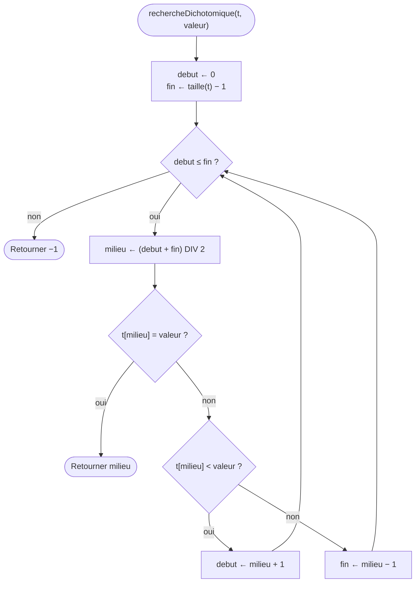

[← Chapitre précédent](07-Algorithmes-sur-les-tableaux.md) · [Sommaire](Readme.md) · [Chapitre suivant →](09-Recursivite-et-complexite.md)

# Trier et chercher

## 🎯 Objectifs

À la fin de ce chapitre, vous saurez :

1. Chercher une valeur dans un tableau, case par case.
2. Chercher beaucoup plus vite dans un tableau trié : la recherche dichotomique.
3. Trier un tableau avec trois algorithmes : par sélection, à bulles, par insertion.
4. Compter les opérations d'un algorithme pour comparer deux méthodes.
5. Utiliser `sort()` correctement, en évitant son piège.

> ⏱ **Durée indicative** : 1 h 30 · **Exercices** : 8.1 à 8.5 obligatoires, 8.6 en approfondissement.

---

## 1. L'idée : le dictionnaire et le jeu de cartes

Pour trouver « ornithorynque » dans un dictionnaire, personne ne lit les pages une à une. On l'ouvre vers le milieu, on regarde un mot, et l'on sait aussitôt dans quelle moitié chercher ; on recommence dans cette moitié, et en quelques gestes on y est. Cette méthode ne marche que pour une raison : **le dictionnaire est trié**.

Trier et chercher sont les deux faces d'un même problème. Un tableau trié se consulte vite, s'affiche proprement (un classement, un annuaire), et révèle ses doublons, qui se retrouvent côte à côte. Pour trier, on fait comme avec un jeu de cartes en main : il existe plusieurs façons de s'y prendre, plus ou moins rapides.

---

## 2. Chercher : la recherche linéaire

La façon la plus simple de chercher : regarder les cases **une par une**, depuis le début, jusqu'à trouver. C'est le patron du drapeau du chapitre 07, qui retourne cette fois la **position** de la valeur, ou **−1** si elle n'y est pas.

```text
FONCTION rechercheLineaire(t : TABLEAU, valeur) : NOMBRE
  POUR i DE 0 À taille(t) − 1 FAIRE
    SI t[i] = valeur ALORS
      RETOURNER i
    FIN SI
  FIN POUR
  RETOURNER −1
FIN FONCTION
```

Pourquoi −1 ? Parce que c'est un indice impossible : il ne peut pas être confondu avec une vraie position. C'est la convention de JavaScript, dont la méthode `indexOf` fait exactement cela.

**Combien de comparaisons ?** Si la valeur est en première case, une seule. Si elle est en dernière case, ou absente, autant que de cases. Pour un tableau d'un million de cases, jusqu'à un million de comparaisons.

---

## 3. Chercher dans un tableau trié : la dichotomie

Jouez au **nombre mystère** : quelqu'un pense à un nombre entre 1 et 100, vous proposez, il répond « plus grand » ou « plus petit ». La meilleure stratégie : proposer **le milieu** de ce qui reste possible. 50 ? Plus grand. 75 ? Plus petit. 62 ? … Chaque réponse élimine la moitié des possibilités : en **7 essais au plus**, vous trouvez.

C'est la **recherche dichotomique** (du grec *dikhotomia*, « couper en deux »). Dans un tableau **trié**, on garde deux bornes, `debut` et `fin`, qui encadrent la zone où la valeur peut encore se trouver, et l'on regarde la case du milieu :



```text
FONCTION rechercheDichotomique(t : TABLEAU, valeur) : NOMBRE
  debut ← 0
  fin ← taille(t) − 1
  TANT QUE debut ≤ fin FAIRE
    milieu ← (debut + fin) DIV 2
    SI t[milieu] = valeur ALORS
      RETOURNER milieu
    SINON SI t[milieu] < valeur ALORS
      debut ← milieu + 1          la valeur est à droite du milieu
    SINON
      fin ← milieu − 1            la valeur est à gauche du milieu
    FIN SI
  FIN TANT QUE
  RETOURNER −1                    la zone est vide : la valeur n'y est pas
FIN FONCTION
```

Le tableau de suivi, en cherchant 23 dans `[2, 5, 8, 12, 16, 23, 38, 56, 72, 91]` :

| Tour | debut | fin | milieu | t[milieu] | Décision |
|---|---|---|---|---|---|
| 1 | 0 | 9 | 4 | 16 | 16 < 23 : à droite, `debut ← 5` |
| 2 | 5 | 9 | 7 | 56 | 56 > 23 : à gauche, `fin ← 6` |
| 3 | 5 | 6 | 5 | 23 | trouvé : retourner 5 |

Trois comparaisons, là où la recherche linéaire en aurait fait six. Et l'écart se creuse vite :

| Taille du tableau | Recherche linéaire, au pire | Dichotomie, au pire |
|---|---|---|
| 10 | 10 | 4 |
| 100 | 100 | 7 |
| 1 000 | 1 000 | 10 |
| 1 000 000 | 1 000 000 | 20 |
| 1 000 000 000 | 1 000 000 000 | 30 |

Chaque fois que le tableau **double**, la dichotomie ne fait qu'**une** comparaison de plus. Mais elle a une condition, non négociable : **le tableau doit être trié**. Sur un tableau en désordre, elle donne de mauvaises réponses, sans le moindre message d'erreur.

À vous de la traduire en JavaScript : c'est l'exercice 8.2.

---

## 4. Trier

Trier, c'est ranger les valeurs d'un tableau dans l'ordre croissant. Voici trois algorithmes classiques, tous simples, tous inspirés de gestes du quotidien.

Tous ont besoin d'**échanger deux cases**. C'est l'échange de deux valeurs du chapitre 03, avec une variable temporaire :

```javascript
const temp = t[i];
t[i] = t[j];
t[j] = temp;
```

> JavaScript sait aussi échanger en une ligne : `[t[i], t[j]] = [t[j], t[i]];`. Le résultat est le même.

### 4.1 Le tri par sélection

L'image : former une file par ordre de taille. On **sélectionne** le plus petit de tous et on le met en tête ; puis le plus petit de ceux qui restent, en deuxième position ; et ainsi de suite.

Sur `[29, 10, 14, 37, 13]` :

| Tour | Partie déjà triée | On cherche le plus petit parmi… | Il vaut… | Après l'échange |
|---|---|---|---|---|
| 0 | | 29, 10, 14, 37, 13 | 10 | **10**, 29, 14, 37, 13 |
| 1 | 10 | 29, 14, 37, 13 | 13 | **10, 13**, 14, 37, 29 |
| 2 | 10, 13 | 14, 37, 29 | 14 | **10, 13, 14**, 37, 29 |
| 3 | 10, 13, 14 | 37, 29 | 29 | **10, 13, 14, 29**, 37 |

```text
POUR i DE 0 À taille(t) − 2 FAIRE
  iMin ← i
  POUR j DE i + 1 À taille(t) − 1 FAIRE
    SI t[j] < t[iMin] ALORS
      iMin ← j
    FIN SI
  FIN POUR
  échanger t[i] et t[iMin]
FIN POUR
```

On y reconnaît le **meilleur jusqu'ici** du chapitre 07, appliqué aux positions : `iMin` retient **où** est le plus petit, pour pouvoir l'échanger.

### 4.2 Le tri à bulles

L'image : des bulles qui remontent à la surface. On parcourt le tableau en comparant chaque case à sa **voisine** ; si elles sont dans le mauvais ordre, on les échange. À la fin d'un passage, la plus grande valeur est « remontée » tout au bout. On recommence avec le reste.

Le premier passage sur `[5, 1, 4, 2, 8]` :

| Comparaison | Échange ? | Tableau |
|---|---|---|
| 5 et 1 | oui | 1, 5, 4, 2, 8 |
| 5 et 4 | oui | 1, 4, 5, 2, 8 |
| 5 et 2 | oui | 1, 4, 2, 5, 8 |
| 5 et 8 | non | 1, 4, 2, 5, **8** |

```text
POUR passe DE 0 À taille(t) − 2 FAIRE
  POUR i DE 0 À taille(t) − 2 − passe FAIRE
    SI t[i] > t[i + 1] ALORS
      échanger t[i] et t[i + 1]
    FIN SI
  FIN POUR
FIN POUR
```

Après chaque passage, une case de plus est à sa place définitive au bout : la boucle intérieure peut s'arrêter `passe` cases plus tôt. Amélioration possible : si un passage n'a fait **aucun** échange, le tableau est trié, et l'on peut s'arrêter. C'est un drapeau.

### 4.3 Le tri par insertion

L'image : trier les cartes que l'on tient en main. On prend la carte suivante et on la fait **glisser vers la gauche** jusqu'à sa place, en décalant d'un cran les cartes plus grandes.

```text
POUR i DE 1 À taille(t) − 1 FAIRE
  carte ← t[i]
  j ← i − 1
  TANT QUE j ≥ 0 ET t[j] > carte FAIRE
    t[j + 1] ← t[j]                décaler la carte plus grande d'un cran à droite
    j ← j − 1
  FIN TANT QUE
  t[j + 1] ← carte                 poser la carte dans le trou
FIN POUR
```

C'est le tri le plus efficace des trois sur un tableau **presque trié** : chaque carte ne glisse que d'un ou deux crans.

### Combien de comparaisons ?

Pour un tableau de `n` cases, le tri par sélection compare chaque case à toutes celles qui la suivent : `(n − 1) + (n − 2) + … + 1`, soit `n × (n − 1) / 2` comparaisons. Les deux autres font, au pire, autant.

| Taille | Comparaisons |
|---|---|
| 10 | 45 |
| 100 | 4 950 |
| 1 000 | 499 500 |
| 10 000 | 49 995 000 |

Quand le tableau est 10 fois plus grand, il y a **100 fois** plus de comparaisons. Le chapitre 09 donne un nom à ce comportement.

---

## 5. Trier en vrai : `sort()`

Dans un vrai projet, on ne réécrit pas son tri : les tableaux JavaScript ont une méthode `sort()`, bien plus rapide que nos trois algorithmes sur de grands tableaux. Mais elle cache un piège.

```javascript
const prenoms = ["Zoé", "Ada", "Léa"];
prenoms.sort();
console.log(prenoms);   // ["Ada", "Léa", "Zoé"]

const nombres = [10, 9, 1, 100];
nombres.sort();
console.log(nombres);   // [1, 10, 100, 9]   ← !
```

Par défaut, `sort()` compare les valeurs **comme du texte**, caractère par caractère : `"10"` passe avant `"9"` parce que `"1"` passe avant `"9"`, comme « baobab » avant « zèbre ». Pour des nombres, il faut lui donner une **fonction de comparaison** :

```javascript
nombres.sort((a, b) => a - b);
console.log(nombres);   // [1, 9, 10, 100]
```

La fonction reçoit deux valeurs `a` et `b`, et retourne un nombre **négatif** si `a` doit venir avant `b`, **positif** si `a` doit venir après, **zéro** si l'ordre est indifférent. `a - b` fait exactement cela pour un ordre croissant ; `b - a` pour un ordre décroissant.

Deux remarques :

- `sort()` **modifie le tableau** sur lequel on l'appelle, et le retourne ;
- pour des textes avec accents, `(a, b) => a.localeCompare(b)` range « Émile » parmi les E, et non après le Z.

---

## 6. Les pièges

- **La dichotomie sur un tableau non trié.** Elle répond n'importe quoi, sans erreur. Triez d'abord.
- **`debut < fin` au lieu de `debut ≤ fin`.** Quand il ne reste qu'une case, `debut` et `fin` sont égaux : avec `<`, on ne la regarde jamais.
- **`debut ← milieu` au lieu de `milieu + 1`.** La zone ne rétrécit plus quand il reste deux cases : boucle infinie.
- **Un milieu à virgule.** `(debut + fin) / 2` donne 4.5 quand `debut + fin` est impair, et `t[4.5]` vaut `undefined`. Il faut le quotient entier : `Math.floor((debut + fin) / 2)`.
- **L'échange sans variable temporaire.** `t[i] = t[j]; t[j] = t[i];` met deux fois la même valeur : l'ancienne valeur de `t[i]` est perdue dès la première ligne.
- **Les bornes des boucles imbriquées.** Dans le tri par sélection, `j` part de `i + 1`, pas de 0. Dans le tri à bulles, `i + 1` doit rester dans le tableau.
- **`sort()` sans comparaison sur des nombres.** `[10, 9, 1].sort()` donne `[1, 10, 9]`.

---

## 7. Exercices

### Exercice 8.1 ⭐ — La recherche linéaire

Écrivez `rechercheLineaire(tableau, valeur)`, qui retourne l'indice de la **première** case égale à `valeur`, ou `-1` si elle n'y est pas. Sans `indexOf`, `findIndex` ni `includes`.

| Appel | Résultat attendu |
|---|---|
| `rechercheLineaire([4, 8, 15, 16], 15)` | `2` |
| `rechercheLineaire([4, 8, 15, 16], 42)` | `-1` |

<details>
<summary>Voir la correction</summary>

<!-- corrigé 8.1 -->
```javascript
function rechercheLineaire(tableau, valeur) {
  for (let i = 0; i < tableau.length; i++) {
    if (tableau[i] === valeur) {
      return i;
    }
  }
  return -1;
}
```

On a besoin de la **position** : c'est un `for` avec indice, pas un `for … of`. Le `return i` s'arrête à la première occurrence ; le `return -1` n'est atteint que si l'on a tout parcouru.

</details>

### Exercice 8.2 ⭐⭐ — La recherche dichotomique

Traduisez le pseudo-code de la section 3 : écrivez `rechercheDichotomique(tableau, valeur)`, qui cherche `valeur` dans un tableau **trié** et retourne son indice, ou `-1`.

| Appel | Résultat attendu |
|---|---|
| `rechercheDichotomique([2, 5, 8, 12, 16, 23, 38, 56, 72, 91], 23)` | `5` |
| `rechercheDichotomique([2, 5, 8, 12, 16, 23, 38, 56, 72, 91], 7)` | `-1` |

Un des tests vérifie que votre fonction est bien une dichotomie : il compte les cases qu'elle lit dans un tableau de 1 000 nombres.

<details>
<summary>Voir la correction</summary>

<!-- corrigé 8.2 -->
```javascript
function rechercheDichotomique(tableau, valeur) {
  let debut = 0;
  let fin = tableau.length - 1;
  while (debut <= fin) {
    const milieu = Math.floor((debut + fin) / 2);
    if (tableau[milieu] === valeur) {
      return milieu;
    } else if (tableau[milieu] < valeur) {
      debut = milieu + 1;
    } else {
      fin = milieu - 1;
    }
  }
  return -1;
}
```

Une traduction ligne à ligne du pseudo-code. Les trois détails qui comptent : `debut <= fin` (et non `<`), `Math.floor` pour un milieu entier, et `milieu + 1` / `milieu - 1` pour que la zone rétrécisse à chaque tour. Pour un tableau de 1 000 cases, la boucle fait au plus 10 tours.

</details>

### Exercice 8.3 ⭐⭐ — Le tri par sélection

Traduisez le pseudo-code de la section 4.1 : écrivez `triSelection(tableau)`, qui trie le tableau reçu dans l'ordre croissant et le retourne. Sans `sort`.

| Appel | Résultat attendu |
|---|---|
| `triSelection([29, 10, 14, 37, 13])` | `[10, 13, 14, 29, 37]` |
| `triSelection([])` | `[]` |

<details>
<summary>Voir la correction</summary>

<!-- corrigé 8.3 -->
```javascript
function triSelection(tableau) {
  for (let i = 0; i < tableau.length - 1; i++) {
    let iMin = i;
    for (let j = i + 1; j < tableau.length; j++) {
      if (tableau[j] < tableau[iMin]) {
        iMin = j;
      }
    }
    const temp = tableau[i];
    tableau[i] = tableau[iMin];
    tableau[iMin] = temp;
  }
  return tableau;
}
```

La boucle extérieure s'arrête à l'avant-dernière case : quand toutes les autres sont à leur place, la dernière l'est forcément. L'échange a lieu même quand `iMin` vaut `i` : il échange alors une case avec elle-même, ce qui ne change rien et évite un `if`.

</details>

### Exercice 8.4 ⭐⭐ — Le tri à bulles

Traduisez le pseudo-code de la section 4.2 : écrivez `triBulles(tableau)`, qui trie le tableau reçu dans l'ordre croissant et le retourne. Sans `sort`.

| Appel | Résultat attendu |
|---|---|
| `triBulles([5, 1, 4, 2, 8])` | `[1, 2, 4, 5, 8]` |
| `triBulles([3, 3, 1])` | `[1, 3, 3]` |

<details>
<summary>Voir la correction</summary>

<!-- corrigé 8.4 -->
```javascript
function triBulles(tableau) {
  for (let passe = 0; passe < tableau.length - 1; passe++) {
    for (let i = 0; i < tableau.length - 1 - passe; i++) {
      if (tableau[i] > tableau[i + 1]) {
        const temp = tableau[i];
        tableau[i] = tableau[i + 1];
        tableau[i + 1] = temp;
      }
    }
  }
  return tableau;
}
```

La condition `i < tableau.length - 1 - passe` garantit que `tableau[i + 1]` existe toujours, et ne revisite pas la fin du tableau, déjà triée. Avec le drapeau « aucun échange pendant ce passage », on peut s'arrêter plus tôt :

```javascript
function triBulles(tableau) {
  let echange = true;
  let passe = 0;
  while (echange) {
    echange = false;
    for (let i = 0; i < tableau.length - 1 - passe; i++) {
      if (tableau[i] > tableau[i + 1]) {
        const temp = tableau[i];
        tableau[i] = tableau[i + 1];
        tableau[i + 1] = temp;
        echange = true;
      }
    }
    passe++;
  }
  return tableau;
}
```

</details>

### Exercice 8.5 ⭐ — Trier des nombres avec `sort()`

Écrivez `trierNombres(tableau)`, qui retourne le tableau trié dans l'ordre croissant, en utilisant `sort()` **correctement**.

| Appel | Résultat attendu |
|---|---|
| `trierNombres([10, 9, 1, 100])` | `[1, 9, 10, 100]` |
| `trierNombres([3, -1, 2])` | `[-1, 2, 3]` |

<details>
<summary>Voir la correction</summary>

<!-- corrigé 8.5 -->
```javascript
function trierNombres(tableau) {
  return tableau.sort((a, b) => a - b);
}
```

Sans la fonction de comparaison, `[10, 9, 1, 100].sort()` donnerait `[1, 10, 100, 9]`. `sort()` retourne le tableau trié : on peut retourner directement son résultat.

</details>

### Exercice 8.6 ⭐⭐⭐ — Le tri par insertion

Traduisez le pseudo-code de la section 4.3 : écrivez `triInsertion(tableau)`, qui trie le tableau reçu dans l'ordre croissant et le retourne. Sans `sort`.

| Appel | Résultat attendu |
|---|---|
| `triInsertion([29, 10, 14, 37, 13])` | `[10, 13, 14, 29, 37]` |
| `triInsertion([5, 4, 3, 2, 1])` | `[1, 2, 3, 4, 5]` |

<details>
<summary>Voir la correction</summary>

<!-- corrigé 8.6 -->
```javascript
function triInsertion(tableau) {
  for (let i = 1; i < tableau.length; i++) {
    const carte = tableau[i];
    let j = i - 1;
    while (j >= 0 && tableau[j] > carte) {
      tableau[j + 1] = tableau[j];
      j--;
    }
    tableau[j + 1] = carte;
  }
  return tableau;
}
```

L'ordre des deux conditions du `while` compte : `j >= 0` est vérifiée **d'abord**, et si elle est fausse, JavaScript ne regarde même pas `tableau[j]`, qui vaudrait `tableau[-1]`. On n'échange rien : on **décale** les cartes plus grandes d'un cran vers la droite, puis on pose la carte dans le trou laissé en `j + 1`.

</details>

---

## ✅ Je sais…

- [ ] écrire une recherche linéaire qui retourne une position, ou −1 ;
- [ ] expliquer pourquoi la dichotomie est si rapide, et à quelle condition elle marche ;
- [ ] exécuter à la main une recherche dichotomique ;
- [ ] décrire avec mes mots le tri par sélection, le tri à bulles et le tri par insertion ;
- [ ] échanger deux cases d'un tableau ;
- [ ] trier des nombres avec `sort((a, b) => a - b)`, et expliquer pourquoi `sort()` seul ne suffit pas.

---

[← Chapitre précédent](07-Algorithmes-sur-les-tableaux.md) · [Sommaire](Readme.md) · [Chapitre suivant →](09-Recursivite-et-complexite.md)
