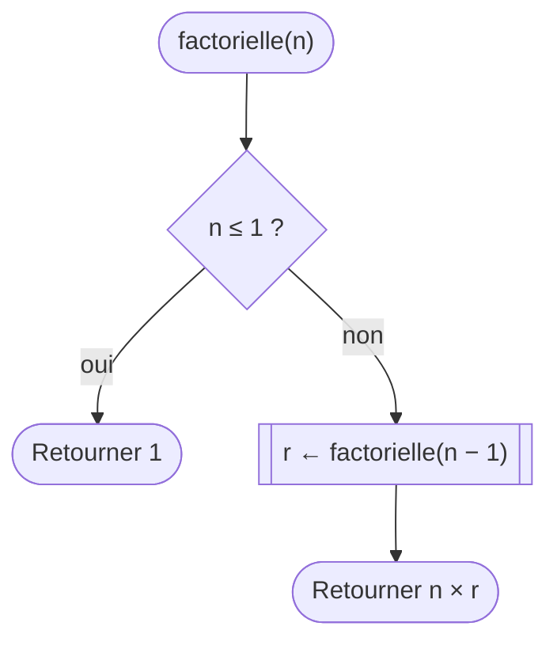

[← Chapitre précédent](08-Trier-et-chercher.md) · [Sommaire](Readme.md) · [Chapitre suivant →](10-Mini-projet-le-nombre-mystere.md)

# Récursivité et complexité

## 🎯 Objectifs

À la fin de ce chapitre, vous saurez :

1. Reconnaître un problème qui se définit à partir d'une version plus petite de lui-même.
2. Écrire une fonction récursive, avec son cas de base et son appel récursif.
3. Suivre l'exécution d'une fonction récursive : la pile d'appels.
4. Estimer le coût d'un algorithme en comptant ses opérations.
5. Comparer des algorithmes avec les notations O(1), O(log n), O(n) et O(n²).

> ⏱ **Durée indicative** : 1 h 15 · **Exercices** : 9.1 à 9.3 obligatoires, 9.4 à 9.6 en approfondissement.
>
> Ce chapitre est le plus théorique du cours. Le socle, ce sont les **idées** : savoir ce qu'est une fonction récursive et lire une notation O(n). Les exercices ⭐⭐⭐ sont pour ceux qui ont le temps ; ne sacrifiez pas le mini-projet pour eux.

---

## 1. L'idée : la file d'attente

Vous êtes dans une longue file d'attente, et vous voulez connaître votre position. Impossible de compter d'où vous êtes. Alors vous demandez à la personne devant vous : « Tu es à quelle position ? » Elle n'en sait rien non plus, et pose la même question à la personne devant elle… jusqu'à la toute première, qui répond sans hésiter : « 1, il n'y a personne devant moi. » La réponse redescend alors la file : « 2 », « 3 », « 4 »… chacun ajoute 1 à la réponse reçue.

> Ma position = la position de la personne devant moi + 1. Et la première personne est en position 1.

C'est une définition **récursive** : elle définit un problème à partir du **même problème, en plus petit**. Une **fonction récursive** est une fonction qui s'appelle elle-même, sur un problème plus petit. Elle a toujours deux ingrédients :

- le **cas de base** : le cas assez petit pour être résolu directement, sans s'appeler. C'est la première personne de la file ;
- l'**appel récursif** : la fonction s'appelle sur un problème **strictement plus petit**, qui se rapproche du cas de base. C'est la question posée à la personne de devant.

Sans cas de base, ou avec un problème qui ne rapetisse pas, la question remonterait la file à l'infini.

---

## 2. Un premier exemple : la factorielle

La **factorielle** d'un entier `n`, notée `n!`, est le produit de tous les entiers de 1 à `n` : `5! = 5 × 4 × 3 × 2 × 1 = 120`. Elle compte, par exemple, de combien de façons on peut ranger `n` livres sur une étagère.

On remarque que `5! = 5 × 4!` : la factorielle de 5 se calcule à partir de celle de 4. D'où la définition récursive :

- `1! = 1` (et `0! = 1`) : le cas de base ;
- `n! = n × (n − 1)!` : l'appel récursif, sur un nombre plus petit.



```text
FONCTION factorielle(n : NOMBRE) : NOMBRE
  SI n ≤ 1 ALORS
    RETOURNER 1                          cas de base
  SINON
    RETOURNER n × factorielle(n − 1)     appel récursif, sur un problème plus petit
  FIN SI
FIN FONCTION
```

```javascript
function factorielle(n) {
  if (n <= 1) {
    return 1;
  }
  return n * factorielle(n - 1);
}

console.log(factorielle(5));   // 120
```

Le code est presque une copie de la définition mathématique : c'est la force de la récursivité.

---

## 3. Ce qui se passe vraiment : la pile d'appels

Que fait l'ordinateur quand on appelle `factorielle(4)` ? Il ne peut pas calculer `4 × factorielle(3)` tant qu'il ne connaît pas `factorielle(3)`. Il met donc ce calcul **en attente**, et lance `factorielle(3)`, qui attend à son tour `factorielle(2)`, et ainsi de suite :

```text
factorielle(4)
│ = 4 × factorielle(3)
│       │ = 3 × factorielle(2)
│       │       │ = 2 × factorielle(1)
│       │       │       │ = 1                     ← cas de base : enfin une réponse
│       │       │ = 2 × 1 = 2
│       │ = 3 × 2 = 6
│ = 4 × 6 = 24
```

Les appels en attente s'**empilent**, comme des assiettes : c'est la **pile d'appels**. Quand le cas de base répond, les appels se **dépilent** dans l'ordre inverse, chacun terminant son calcul avec la réponse reçue. Exactement comme la réponse qui redescend la file d'attente.

Pour **voir** la pile d'appels évoluer pas à pas, collez la fonction et un appel dans [Python Tutor](https://pythontutor.com/javascript.html), qui sait aussi exécuter du JavaScript : il dessine chaque appel en attente, avec ses variables.

Si le cas de base manque, ou n'est jamais atteint, les appels s'empilent sans fin, jusqu'à ce que la pile déborde : JavaScript s'arrête sur `RangeError: Maximum call stack size exceeded`. C'est le fameux **débordement de pile**, le *stack overflow* qui a donné son nom au site d'entraide des développeurs.

---

## 4. Récursif ou itératif ?

Tout ce qui s'écrit avec une fonction récursive peut s'écrire avec une boucle (on dit alors **itératif**), et inversement. La factorielle, avec un accumulateur :

```javascript
function factorielle(n) {
  let produit = 1;
  for (let i = 2; i <= n; i++) {
    produit = produit * i;
  }
  return produit;
}
```

Alors, pourquoi la récursivité ? Parce que certains problèmes sont **naturellement emboîtés**, et que la version récursive y est bien plus simple :

- les **dossiers** d'un disque, qui contiennent des fichiers et d'autres dossiers, qui contiennent… : compter tous les fichiers, c'est compter ceux du dossier, plus ceux de chaque sous-dossier ;
- le **DOM** d'une page web, où chaque élément contient d'autres éléments ;
- un document **JSON** imbriqué ;
- les **tris rapides** (tri fusion, tri rapide), qui coupent le tableau en deux, trient chaque moitié… récursivement.

Pour un traitement linéaire, comme une somme ou un parcours, la boucle reste en général plus simple et moins gourmande. La récursivité est un outil de plus, pas un remplaçant.

---

## 5. La complexité : combien ça coûte ?

Au chapitre 08, la recherche linéaire regardait jusqu'à un million de cases là où la dichotomie en regardait vingt. Comment comparer des algorithmes de façon générale ?

Pas en secondes : la durée dépend de l'ordinateur. On compte plutôt le **nombre d'opérations** élémentaires, et surtout **comment ce nombre grandit quand les données grandissent**. Si `n` est la taille des données, par exemple le nombre de cases d'un tableau, on se demande : quand `n` double, le travail double-t-il ? Quadruple-t-il ? Ne bouge-t-il presque pas ?

### Quatre familles à connaître

| Notation | Nom | Quand `n` double… | L'image | Exemples du cours |
|---|---|---|---|---|
| O(1) | constant | rien ne change | prendre le livre du dessus de la pile | `t[0]`, `t.length`, `estPair` |
| O(log n) | logarithmique | **une** opération de plus | chercher un mot dans le dictionnaire | recherche dichotomique |
| O(n) | linéaire | le travail double | lire un livre page par page | somme, maximum, recherche linéaire |
| O(n²) | quadratique | le travail **quadruple** | chaque invité serre la main de tous les autres | tris par sélection, à bulles, par insertion |

La notation « O de… » se lit « grand O de… » et décrit le comportement **dans le pire des cas**, pour de **grandes** valeurs de `n`. On ne garde que l'essentiel : un algorithme qui fait `3n + 2` opérations est en O(n), parce que pour un grand `n`, c'est le `n` qui compte, pas le 3 ni le 2.

Ce que ces familles signifient concrètement, en nombre d'opérations :

| n | O(1) | O(log n) | O(n) | O(n²) |
|---|---|---|---|---|
| 10 | 1 | ≈ 3 | 10 | 100 |
| 1 000 | 1 | ≈ 10 | 1 000 | 1 000 000 |
| 1 000 000 | 1 | ≈ 20 | 1 000 000 | 1 000 000 000 000 |

À un milliard d'opérations par seconde, la dernière case représente près de **17 minutes** ; la case voisine, un millième de seconde.

### Estimer la complexité d'un algorithme

Pas besoin de formule : il suffit de regarder les **boucles sur les données** :

- **pas de boucle** sur les données : O(1) ;
- **une boucle** qui parcourt les données : O(n) ;
- **deux boucles imbriquées** qui parcourent chacune les données : O(n²) ;
- **une boucle qui divise** la zone de travail par deux à chaque tour : O(log n).

### L'expérience

Copiez ce programme dans le **bac à sable console** et exécutez-le. Il compte combien de cases chaque algorithme regarde, pour des tableaux de plus en plus grands :

```javascript
// Combien de cases chaque algorithme regarde-t-il ?
function lineaire(t, valeur) {
  let regards = 0;
  for (let i = 0; i < t.length; i++) {
    regards++;
    if (t[i] === valeur) {
      return regards;
    }
  }
  return regards;
}

function dichotomie(t, valeur) {
  let regards = 0;
  let debut = 0;
  let fin = t.length - 1;
  while (debut <= fin) {
    regards++;
    const milieu = Math.floor((debut + fin) / 2);
    if (t[milieu] === valeur) {
      return regards;
    } else if (t[milieu] < valeur) {
      debut = milieu + 1;
    } else {
      fin = milieu - 1;
    }
  }
  return regards;
}

function triSelection(t) {
  let comparaisons = 0;
  for (let i = 0; i < t.length - 1; i++) {
    let iMin = i;
    for (let j = i + 1; j < t.length; j++) {
      comparaisons++;
      if (t[j] < t[iMin]) {
        iMin = j;
      }
    }
    const temp = t[i];
    t[i] = t[iMin];
    t[iMin] = temp;
  }
  return comparaisons;
}

for (const n of [10, 100, 1000, 10000]) {
  const t = [];
  for (let i = 0; i < n; i++) {
    t.push(i);
  }
  // On cherche une valeur absente, plus grande que toutes : le pire des cas.
  console.log("n = " + n + " : linéaire " + lineaire(t, n) + ", dichotomie " + dichotomie(t, n) +
    ", tri par sélection " + triSelection(t));
}
```

Ce qu'il affiche :

```text
n = 10 : linéaire 10, dichotomie 4, tri par sélection 45
n = 100 : linéaire 100, dichotomie 7, tri par sélection 4950
n = 1000 : linéaire 1000, dichotomie 10, tri par sélection 499500
n = 10000 : linéaire 10000, dichotomie 14, tri par sélection 49995000
```

Quand `n` est multiplié par 10 : la recherche linéaire fait 10 fois plus de travail, la dichotomie 3 ou 4 regards de plus seulement, le tri par sélection 100 fois plus. Les trois familles O(n), O(log n) et O(n²), sous vos yeux.

### Ce qu'il faut en retenir pour la pratique

- **Pour de petites données, tout est rapide.** Ne compliquez pas un programme pour gagner une milliseconde sur 20 éléments.
- **Méfiez-vous des boucles cachées.** `includes`, `indexOf`, `filter` ou `sort` parcourent le tableau. Un `includes` **dans** une boucle, ce sont deux boucles imbriquées : O(n²).
- **Changer d'algorithme rapporte plus qu'optimiser une ligne.** Passer d'une recherche linéaire à une dichotomie, ou d'un tri par sélection à `sort()`, change l'ordre de grandeur, pas seulement quelques pourcents.

---

## 6. Les pièges

- **Le cas de base oublié, ou jamais atteint.** `sommeJusqua(-1)` avec un cas de base `n === 0` descend vers −2, −3… sans jamais l'atteindre. Un cas de base `n <= 0` est plus robuste.
- **Le problème qui ne rapetisse pas.** Un appel `f(n)` à l'intérieur de `f(n)` tourne en rond : il faut `f(n - 1)`, `f(n / 2)`… quelque chose de plus petit.
- **Le `return` oublié devant l'appel récursif.** `n * factorielle(n - 1);` calcule le résultat… et le jette. Il faut `return n * factorielle(n - 1);`.
- **Recalculer cent fois la même chose.** Certaines fonctions récursives, comme Fibonacci (exercice 9.5), recalculent les mêmes valeurs un nombre gigantesque de fois.
- **Confondre secondes et complexité.** Un programme rapide sur votre poste avec 100 éléments peut devenir inutilisable avec 100 000. La complexité prévoit ce qui se passera quand les données grandiront.

---

## 7. Exercices

### Exercice 9.1 ⭐ — La somme, récursivement

Écrivez une fonction **récursive** `sommeJusqua(n)`, qui retourne `1 + 2 + … + n`, et 0 pour `n` inférieur ou égal à 0. Pas de boucle : la fonction doit s'appeler elle-même.

| Appel | Résultat attendu |
|---|---|
| `sommeJusqua(4)` | `10` |
| `sommeJusqua(0)` | `0` |

<details>
<summary>Voir la correction</summary>

La somme jusqu'à `n`, c'est `n` plus la somme jusqu'à `n − 1`. Et la somme jusqu'à 0 vaut 0.

<!-- corrigé 9.1 -->
```javascript
function sommeJusqua(n) {
  if (n <= 0) {
    return 0;
  }
  return n + sommeJusqua(n - 1);
}
```

`sommeJusqua(4)` = 4 + `sommeJusqua(3)` = 4 + 3 + `sommeJusqua(2)` = 4 + 3 + 2 + 1 + `sommeJusqua(0)` = 4 + 3 + 2 + 1 + 0 = 10. Le cas de base `n <= 0` couvre aussi les nombres négatifs.

</details>

### Exercice 9.2 ⭐⭐ — La puissance

Écrivez une fonction **récursive** `puissance(x, n)`, qui retourne `x` multiplié par lui-même `n` fois (`n` entier positif ou nul). Par définition, `x⁰ = 1`. Sans `**` ni `Math.pow`.

| Appel | Résultat attendu |
|---|---|
| `puissance(2, 10)` | `1024` |
| `puissance(5, 0)` | `1` |

<details>
<summary>Voir la correction</summary>

`xⁿ = x × xⁿ⁻¹`, et `x⁰ = 1`.

<!-- corrigé 9.2 -->
```javascript
function puissance(x, n) {
  if (n === 0) {
    return 1;
  }
  return x * puissance(x, n - 1);
}
```

Seul `n` rapetisse d'un appel à l'autre ; `x` reste le même. Pour `puissance(2, 10)`, il y a 10 appels avant le cas de base : c'est un algorithme en O(n).

Pour aller plus loin : `x¹⁰ = (x⁵)²`. En divisant `n` par deux quand il est pair, on peut calculer `x¹⁰⁰⁰` en une vingtaine d'appels au lieu de mille : c'est l'**exponentiation rapide**, en O(log n).

</details>

### Exercice 9.3 ⭐⭐ — Quelle complexité ?

Dans le playground (exercice 9.3, sans test automatique), donnez la complexité de chacune de ces fonctions, écrites dans les chapitres précédents ou ci-dessous, pour un tableau de taille `n` :

1. `estPair(n)`, exercice 6.1 ;
2. `somme(tableau)`, exercice 7.1 ;
3. `estTrie(tableau)`, exercice 7.8 ;
4. `rechercheDichotomique(tableau, valeur)`, exercice 8.2 ;
5. `triBulles(tableau)`, exercice 8.4 ;
6. cette fonction, qui dit si un tableau contient un doublon :

```javascript
function aUnDoublon(tableau) {
  for (let i = 0; i < tableau.length; i++) {
    if (tableau.indexOf(tableau[i]) !== i) {
      return true;
    }
  }
  return false;
}
```

<details>
<summary>Voir la correction</summary>

1. **O(1)** : un seul calcul, quel que soit le nombre.
2. **O(n)** : une boucle qui parcourt le tableau une fois.
3. **O(n)** au pire : une boucle sur le tableau. Si deux voisins sont mal rangés tout au début, elle s'arrête tout de suite ; mais la complexité parle du **pire** des cas, un tableau trié qu'il faut parcourir en entier.
4. **O(log n)** : la zone de recherche est divisée par deux à chaque tour.
5. **O(n²)** : deux boucles imbriquées sur le tableau.
6. **O(n²)**, malgré une seule boucle visible : `indexOf` parcourt le tableau depuis le début, à chaque tour. C'est une **boucle cachée**. Pour 100 000 éléments, cela peut représenter des milliards d'opérations. En triant d'abord le tableau, les doublons se retrouvent côte à côte, et un seul parcours suffit ensuite.

</details>

### Exercice 9.4 ⭐⭐⭐ — La somme des chiffres

Écrivez une fonction **récursive** `sommeChiffres(n)`, qui retourne la somme des chiffres d'un entier positif : `1234` donne `1 + 2 + 3 + 4 = 10`.

| Appel | Résultat attendu |
|---|---|
| `sommeChiffres(1234)` | `10` |
| `sommeChiffres(7)` | `7` |

<details>
<summary>Voir la correction</summary>

Le dernier chiffre de `n` est `n MOD 10` (`1234 MOD 10 = 4`), et les autres chiffres forment `n DIV 10` (`123`). La somme des chiffres de 1234 est donc 4 plus la somme des chiffres de 123. Un nombre d'un seul chiffre est son propre total.

<!-- corrigé 9.4 -->
```javascript
function sommeChiffres(n) {
  if (n < 10) {
    return n;
  }
  return (n % 10) + sommeChiffres(Math.floor(n / 10));
}
```

`DIV` et `MOD`, du chapitre 03, servent ici à découper un nombre en chiffres. Le nombre perd un chiffre à chaque appel : il finit forcément par passer sous 10.

</details>

### Exercice 9.5 ⭐⭐⭐ — Fibonacci

La suite de **Fibonacci** commence par 0 et 1 ; chaque terme suivant est la somme des deux précédents : 0, 1, 1, 2, 3, 5, 8, 13, 21… Écrivez une fonction **récursive** `fibonacci(n)`, qui retourne le terme numéro `n`, avec `fibonacci(0) = 0` et `fibonacci(1) = 1`.

| Appel | Résultat attendu |
|---|---|
| `fibonacci(7)` | `13` |
| `fibonacci(20)` | `6765` |

Une fois les tests passés, essayez dans le bac à sable `console.log(fibonacci(30))`, puis `fibonacci(35)`, puis `fibonacci(45)`. Que se passe-t-il ? Pourquoi ?

<details>
<summary>Voir la correction</summary>

<!-- corrigé 9.5 -->
```javascript
function fibonacci(n) {
  if (n <= 1) {
    return n;
  }
  return fibonacci(n - 1) + fibonacci(n - 2);
}
```

Deux cas de base en un : `fibonacci(0)` retourne 0 et `fibonacci(1)` retourne 1. Et **deux** appels récursifs.

`fibonacci(30)` répond tout de suite, `fibonacci(35)` met un moment, et `fibonacci(45)` est arrêté par le playground au bout de 3 secondes. La raison : chaque appel en lance **deux** autres, et la fonction recalcule sans cesse les mêmes valeurs. `fibonacci(5)` appelle `fibonacci(3)` deux fois, `fibonacci(2)` trois fois… Le nombre d'appels **double presque** à chaque fois que `n` augmente de 1 : c'est une complexité **exponentielle**, notée O(2ⁿ), bien pire que O(n²). Pour `n = 45`, il faudrait plus de deux milliards d'appels.

La parade : retenir les valeurs déjà calculées, ou calculer la suite avec une boucle, du premier terme au dernier, en O(n) :

```javascript
function fibonacci(n) {
  let avant = 0;
  let courant = 1;
  for (let i = 0; i < n; i++) {
    const suivant = avant + courant;
    avant = courant;
    courant = suivant;
  }
  return avant;
}
```

</details>

### Exercice 9.6 ⭐⭐⭐ — Palindrome

Un **palindrome** se lit de la même façon dans les deux sens : `kayak`, `radar`, `été`. Écrivez une fonction **récursive** `estPalindrome(mot)`, qui retourne `true` si le mot est un palindrome. Un mot vide ou d'une seule lettre en est un.

Rappels : `mot[0]` est la première lettre, `mot[mot.length - 1]` la dernière, et `mot.slice(1, -1)` le mot sans sa première ni sa dernière lettre.

| Appel | Résultat attendu |
|---|---|
| `estPalindrome("kayak")` | `true` |
| `estPalindrome("bonjour")` | `false` |

<details>
<summary>Voir la correction</summary>

Un mot est un palindrome si sa première et sa dernière lettre sont identiques, **et** si ce qu'il y a entre les deux est un palindrome.

<!-- corrigé 9.6 -->
```javascript
function estPalindrome(mot) {
  if (mot.length <= 1) {
    return true;
  }
  if (mot[0] !== mot[mot.length - 1]) {
    return false;
  }
  return estPalindrome(mot.slice(1, -1));
}
```

Deux cas d'arrêt : le mot est trop court pour échouer (`true`), ou ses extrémités diffèrent (`false`). Sinon, on rogne une lettre de chaque côté et l'on recommence : le mot raccourcit de deux lettres à chaque appel.

</details>

---

## ✅ Je sais…

- [ ] expliquer ce qu'est une fonction récursive, avec l'image de la file d'attente ;
- [ ] identifier le cas de base et l'appel récursif d'une fonction ;
- [ ] écrire une fonction récursive simple ;
- [ ] expliquer ce qu'est la pile d'appels, et d'où vient l'erreur `Maximum call stack size exceeded` ;
- [ ] dire si un algorithme est en O(1), O(log n), O(n) ou O(n²), en regardant ses boucles ;
- [ ] repérer une boucle cachée dans une méthode toute faite.

---

[← Chapitre précédent](08-Trier-et-chercher.md) · [Sommaire](Readme.md) · [Chapitre suivant →](10-Mini-projet-le-nombre-mystere.md)
